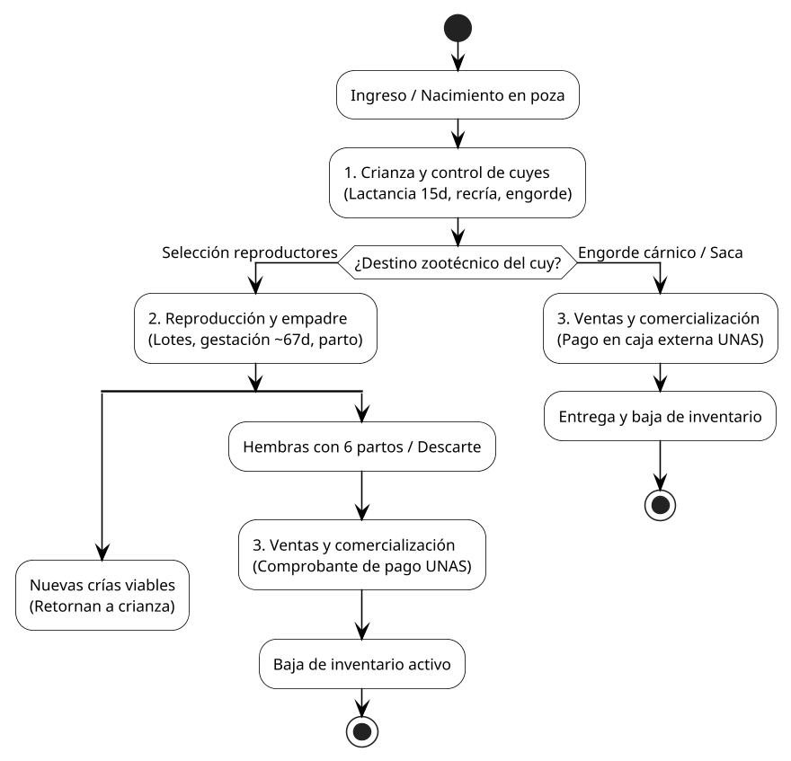
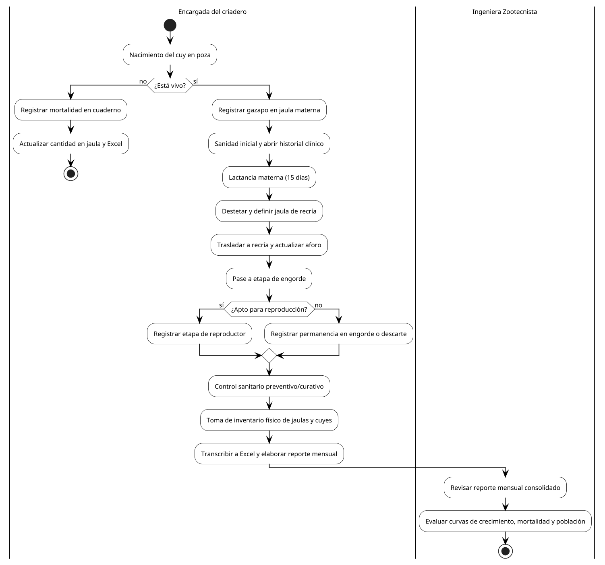
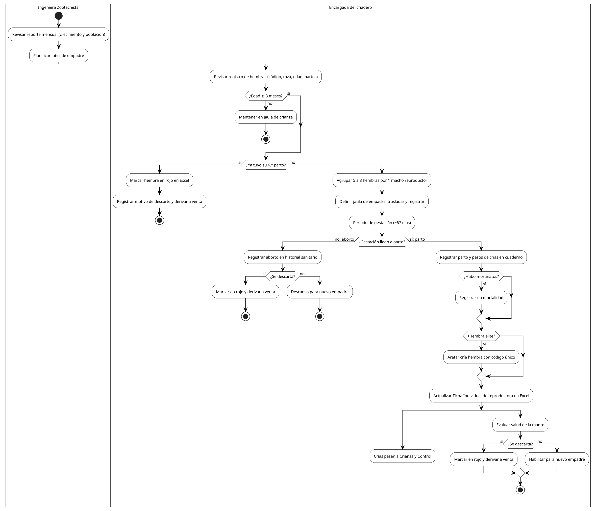
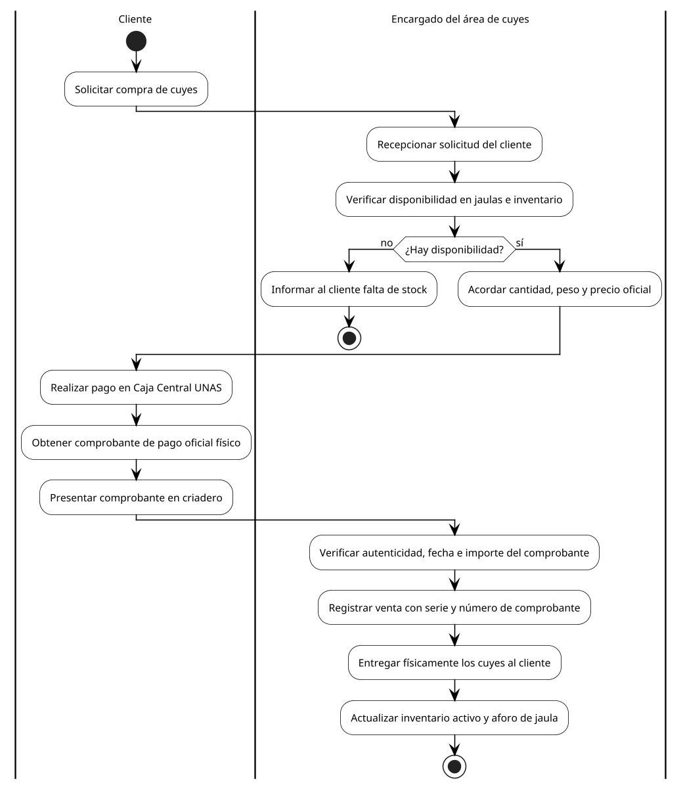

# 1. Descripción del caso de negocio

## 1.1. Contexto institucional y diagnóstico operativo

El sistema tiene como propósito gestionar y garantizar la trazabilidad integral del ciclo productivo y reproductivo de los cuyes (*Cavia porcellus*) en el Laboratorio de Crianza de la Facultad de Zootecnia de la Universidad Nacional Agraria de la Selva (UNAS), ubicado en Tingo María, Huánuco. Esta unidad cumple un doble rol estratégico en la institución: por un lado, funciona como centro de investigación zootécnica y mejoramiento genético de líneas cárnicas y prolíficas; por otro, opera como una unidad de producción y abastecimiento pecuario para la comunidad universitaria y el mercado local.

Actualmente, el control de las actividades operativas (nacimientos, destetes, recría, engorde, empadres, controles sanitarios, pesajes y salidas comerciales) se realiza de forma manual mediante anotaciones en cuadernos de campo físicos y hojas de cálculo aisladas en Microsoft Excel. El levantamiento de información y la auditoría de los registros históricos del criadero confirman que este esquema de trabajo tradicional presenta serias vulnerabilidades y fallas estructurales:

1. **Duplicidad y desarticulación de registros:** Los eventos deben registrarse primero a mano en el campo y transcribirse posteriormente a múltiples plantillas de Excel no vinculadas (cuaderno de partos, hoja de mortalidad, ficha de reproductoras, inventario mensual), lo que consume hasta un 40% del tiempo operativo del personal e introduce errores humanos recurrentes.
2. **Inconsistencias y ausencia de validación de datos:** Se han identificado en los registros oficiales fechas biológicamente imposibles (formatos truncados o años invertidos), identificadores con múltiples grafías para un mismo animal (por ejemplo, variantes tipográficas como `UM24`, `UM 24` y `Uum24`), y estados zootécnicos escritos con texto libre que impiden la consolidación automática.
3. **Pérdida de trazabilidad genealógica y biológica:** Al manejarse los datos en celdas aisladas, resulta complejo reconstruir el árbol genealógico completo de un reproductor (padre, madre, camadas previas) y verificar indicadores críticos como el límite de vida útil productiva (tope de 6 partos por hembra) o la proyección estricta de la curva de gestación (~67 días).
4. **Desfases entre el inventario físico y lógico:** La falta de sincronización inmediata ante movimientos de jaula, nacimientos no contabilizados a tiempo, mortalidades no conciliadas o ventas registradas tardíamente genera discrepancias sistemáticas entre el conteo de animales en pozas y las existencias formales.
5. **Riesgo en el flujo de comercialización:** Las ventas dependen de comprobantes emitidos físicamente por la caja externa de recaudación de la UNAS. Sin una validación sistematizada de la serie y número del comprobante que descuente de manera atómica los animales del inventario, existe el riesgo de entregar ejemplares no disponibles o no conciliar los ingresos frente a las bajas de la piara.

Para resolver de raíz esta problemática, se diseña y desarrolla una plataforma web modular que digitaliza y centraliza el ciclo productivo completo: desde el nacimiento, destete y recría hasta las salidas definitivas por venta, descarte o mortalidad. En el flujo operativo, el sistema soporta la toma de decisiones sobre el destino del cuy (reproducción con retorno de crías al ciclo de crianza, o pase a venta) y automatiza el proceso de ventas verificando la disponibilidad en jaulas, validando la serie y número del comprobante de pago emitido por caja externa, y descontando de forma inmediata los ejemplares del inventario activo, optimizando la gestión zootécnica y la toma de decisiones.

---

## 1.2. Estructura y arquitectura de procesos de negocio AS-IS

Para modelar formalmente la operación del criadero, se ha estructurado una arquitectura de procesos jerárquica de dos niveles de abstracción:

- **Macroproceso de Nivel 0 (AS-IS CUY):** Representa el ciclo de vida productivo de punta a punta, coordinando las fases troncales desde el ingreso/nacimiento hasta las derivaciones por reproducción, engorde comercial y salidas definitivas.
- **Subprocesos operativos de Nivel 1:** Detallan los procedimientos específicos ejecutados por los diferentes roles funcionales mediante diagramas de carriles (*swimlanes*) en BPMN:
  - **Subproceso 1.3:** Crianza y control de cuyes (modelado en `cuyeyos.bpm`).
  - **Subproceso 1.4:** Ciclo reproductivo y empadre (modelado en `AS-IS_Reproduccion.png`).
  - **Subproceso 1.5:** Comercialización y ventas (modelado en `AS-IS_ventas.png`).

---

## 1.3. Macroproceso de negocio AS-IS (Nivel 0: Flujo General de Producción y Salidas)

El macroproceso integra las tres fases cardinales del criadero: la fase de crecimiento y desarrollo animal (**Crianza y control de cuyes**), la fase de multiplicación genética (**Reproducción**) y la fase de egreso formal (**Comercialización y ventas**), además de los canales de salida por descarte zootécnico y mortalidad.

### Dinámica del macroproceso Nivel 0

1. **Ingreso y desarrollo en crianza:** Todo ejemplar ingresa al sistema al momento de su alumbramiento. En la fase de crianza atraviesa las etapas de gazapo (lactancia materna de 15 días), destete, recría y engorde. Durante este trayecto se le aplican controles biométricos de peso, manejos profilácticos sanitarios y reubicaciones de jaula conforme evoluciona su tamaño corporal.
2. **Evaluación de destino zootécnico:** Al culminar el desarrollo juvenil, se evalúa el potencial biológico del animal según antecedentes de prolificidad materna, velocidad de crecimiento y sanidad:
   - **Ruta a Reproducción:** Los machos y hembras que cumplen los estándares de selección se incorporan al plantel de reproductores y se organizan en lotes de empadre. Al culminar la gestación y el parto, las nuevas crías viables retornan a la fase de **Crianza y control de cuyes**, cerrando el ciclo de retroalimentación de la piara.
   - **Ruta a Ventas y comercialización:** Los cuyes que culminan su fase de engorde cárnico (destinados al consumo) y los reproductores que han culminado su vida reproductiva útil (descarte zootécnico por alcanzar su 6.° parto o senescencia) son dirigidos al canal de comercialización formal.
   - **Bajas por mortalidad:** Aquellos ejemplares que fallecen por causas perinatales, infecciosas o traumáticas son dados de baja de la población activa y canalizados al registro de mortalidad y necropsia.

---

## 1.4. Subproceso de Nivel 1: Crianza y control de cuyes (`cuyeyos.bpm`)

Este subproceso modela la totalidad de las actividades zootécnicas y administrativas rutinarias que permiten acompañar al animal desde su nacimiento hasta su destino productivo final.

### Caracterización técnica del subproceso

| Parámetro | Detalle técnico |
|---|---|
| **Nombre del proceso** | Crianza y control de cuyes |
| **Fuente de modelado** | Archivo XPDL 2.2 / Bizagi Process Modeler (`cuyeyos.bpm`) |
| **Objetivo** | Controlar el crecimiento, sanidad, movimientos de jaula y densidad de población de los animales en desarrollo, asegurando la continuidad de la piara y la exactitud de los inventarios físicos y lógicos. |
| **Alcance** | Desde la detección del parto y evaluación de viabilidad del gazapo recién nacido hasta el reporte mensual y análisis de curvas de crecimiento. |
| **Roles / Carriles** | 1. **Encargada del criadero:** Ejecución operativa directa en pozas, alimentación, sanidad, movimientos, pesajes y registro manual. 2. **Ingeniera Zootecnista:** Supervisión técnica, aprobación de reportes de producción, cálculo de indicadores y planificación de lotes. |
| **Entradas** | Partos ocurridos, registros de hembras gestantes, disponibilidad de pozas, suministros sanitarios y de pesaje. |
| **Salidas** | Fichas de gazapos registradas, traslados actualizados, historiales sanitarios documentados, inventarios físicos consolidados y reporte mensual formal. |

### Secuencia detallada de actividades del subproceso

1. **Recepción del nacimiento y tamizaje de viabilidad (*¿Está vivo?*):**
   - La encargada inspecciona diariamente las pozas de maternidad. Al detectar un alumbramiento, evalúa de forma inmediata la viabilidad biológica de cada cría.
   - **Caso no viable (Mortinato):** Si la cría nace muerta, la encargada registra el evento en el cuaderno de mortalidad indicando fecha, jaula y presunta causa; actualiza la cantidad de animales en la jaula materna y transcribe posteriormente la información a la hoja de cálculo de mortalidad e inventario de Excel, finalizando allí el flujo para dicha cría.
   - **Caso viable (Gazapo vivo):** Si la cría está viva, se procede con su alta inicial: se registra al animal, se asigna su ubicación formal en la jaula de su madre, se le practica el protocolo de sanidad inicial (administración de complejo vitamínico B y desinfección umbilical) y se abre su historial clínico. Todos estos datos se transcriben en el cuaderno de campo y el gazapo entra en período de lactancia.
2. **Lactancia y monitoreo del plazo de destete (*¿Cumplió 15 días?*):**
   - El gazapo permanece junto a la madre alimentándose de leche materna e introduciéndose progresivamente al consumo de forraje verde fresco.
   - La encargada monitorea la edad del animal: si no ha cumplido los 15 días biológicos estipulados, continúa su cuidado en la jaula materna; una vez cumplido el plazo de 15 días, se ejecuta el destete.
3. **Destete, traslado físico y control de aforo en recría:**
   - Se separa físicamente al gazapo de la madre, se define la jaula de recría de destino (segregando por sexo y raza) y se efectúa el traslado.
   - Se registra el cambio a etapa de destete/recría, se actualizan las capacidades y aforos de las jaulas involucradas y se transcribe el evento a las planillas de Excel.
4. **Culminación de recría y transición a engorde (*¿Terminó la etapa de recría?*):**
   - El cuy permanece en recría desarrollando masa muscular y estructura ósea. Si la etapa aún no concluye, se continúa el manejo rutinario en recría.
   - Al finalizar la recría, se registra formalmente el paso a la etapa de engorde. Se evalúa si el animal requiere cambio de poza (*¿Requiere cambio de jaula?*): si lo requiere, se define la nueva poza, se realiza el traslado, se anota en el registro actualizando el aforo y se transcribe a Excel; en caso contrario, se mantiene en la misma jaula optimizando el espacio.
5. **Evaluación de antecedentes productivos y selección de reproductores (*¿Se selecciona para reproducción?*):**
   - Durante la fase de engorde, la encargada y la ingeniera evalúan el desarrollo ponderal, la conformación zootécnica y los antecedentes de los progenitores del animal.
   - **Si es seleccionado para reproducción:** Se registra su cambio de condición a reproductor/reproductora de reemplazo.
   - **Si no es seleccionado:** Se registra su permanencia en la categoría de engorde comercial con destino a saca/venta, o descarte por fallas fenotípicas.
   - En ambos casos se asientan las modificaciones en el cuaderno de campo. Se evalúa si se requiere reubicación física de jaula (*¿Requiere cambio de jaulas?*): de ser necesario, se define la poza según la selección, se traslada anotando fecha, origen, destino y motivo, y se actualiza la ocupación de ambas jaulas.
6. **Manejo sanitario preventivo y curativo:**
   - Se aplican los controles sanitarios rutinarios (baños antiparasitarios, dosificaciones profilácticas trimestrales y tratamientos curativos ante infecciones respiratorias o digestivas).
   - Se anota la fecha de intervención, el diagnóstico, el medicamento empleado, la dosis y las observaciones en el historial clínico del animal o poza.
7. **Toma de inventarios físicos y consolidación mensual:**
   - Hacia el cierre del mes, la encargada realiza la revisión física exhaustiva del inventario de jaulas (pozas activas, dañadas y aforos disponibles) e inventario físico de cuyes por conteo directo.
   - Se transcriben los resultados a las matrices de inventario de Excel y se elabora el informe técnico de producción mensual.
8. **Revisión, validación y control por la Ingeniera Zootecnista:**
   - La Ingeniera recibe el informe mensual elaborado por la encargada.
   - Examina los indicadores consolidados de población, mortalidad, prolificidad y curvas de crecimiento por raza, validando los resultados para retroalimentar la planificación zootécnica del siguiente ciclo.

---

## 1.5. Subproceso de Nivel 1: Ciclo reproductivo y empadre (`AS-IS_Reproduccion.png`)

Modela la gestión técnica de los empadres, la evaluación de fertilidad de las reproductoras, el seguimiento de la gestación, el manejo del parto y la renovación o descarte del plantel de cría.

### Caracterización técnica del subproceso

| Parámetro | Detalle técnico |
|---|---|
| **Nombre del proceso** | Ciclo reproductivo y empadre |
| **Fuente de modelado** | Diagrama BPMN formal de reproducción (`AS-IS_Reproduccion.png`) |
| **Objetivo** | Maximizar la fertilidad y prolificidad del criadero mediante la planificación rigurosa de empadres, control de la gestación (~67 días), atención oportuna de partos y descarte programado de hembras al 6.° parto. |
| **Alcance** | Desde la planificación técnica de empadres por la Ingeniera hasta la incorporación de nuevas crías a crianza y la derivación de hembras descartadas a ventas. |
| **Roles / Carriles** | 1. **Ingeniera Zootecnista:** Análisis demográfico de la piara y planificación técnica de empadres. 2. **Encargada del criadero:** Selección física de hembras, formación de lotes, seguimiento de gestación, atención del parto, aretado y descarte. |
| **Parámetros zootécnicos clave** | - **Edad mínima de empadre:** 3 meses (90 días). - **Relación de empadre:** 1 macho por 5 a 8 hembras en jaula colectiva. - **Período de gestación:** 67 días promedio. - **Límite de vida reproductiva útil:** Máximo 6 partos por hembra reproductora. |
| **Entradas** | Reporte mensual zootécnico, registros individuales de hembras y machos, disponibilidad de pozas de empadre. |
| **Salidas** | Lotes de empadre constituidos, partos registrados, crías vivas incorporadas a crianza, mortinatos asentados y hembras de 6.° parto derivadas a venta. |

### Secuencia detallada de actividades del subproceso

1. **Planificación de empadres por la Ingeniera:**
   - La Ingeniera Zootecnista examina los informes técnicos de evolución de la población, índices de mortalidad y curvas de peso por raza para determinar cuántos nuevos lotes de empadre deben conformarse y qué líneas genéticas deben priorizarse.
2. **Revisión de hembras y validación de reglas biológicas:**
   - La encargada del criadero consulta el cuaderno de campo y las hojas de Excel filtrando las hembras candidatas. Evalúa obligatoriamente: código de la hembra, raza, jaula actual, fecha de nacimiento, edad calculada y número de partos registrados.
   - **Regla zootécnica de edad (*¿La hembra tiene 3 meses o más de edad?*):** Si la hembra no ha alcanzado los 3 meses de vida, se mantiene en su poza de recría/crianza hasta completar su madurez física, retornando a la rutina de crianza.
   - **Regla de vida útil (*¿Ya tuvo su sexto parto?*):** Si la hembra ya cumplió su 6.° parto, ha alcanzado el límite zootécnico de productividad. La encargada la marca visualmente en color rojo en la plantilla de Excel, registra el motivo del descarte (senescencia o agotamiento reproductivo) y su destino (venta de saca o descarte definitivo), derivándola inmediatamente a la poza de venta.
3. **Conformación del lote de empadre y apareamiento:**
   - Si la hembra tiene 3 meses o más y menos de 6 partos, se agrupa en una poza colectiva junto con otras hembras aptas, respetando la relación técnica de **5 a 8 hembras por cada macho reproductor**.
   - Se selecciona y asigna un macho reproductor calificado, se define la jaula de empadre y se traslada al grupo.
   - Se anota el movimiento de traslado actualizando el aforo de las jaulas (registrando código de los animales, fecha, jaula de origen, jaula de destino y motivo).
   - Se formaliza el empadre en el cuaderno de campo (registrando jaula, raza, código de cada hembra, código del macho y fecha de inicio de empadre) y se transcribe a Excel.
4. **Seguimiento del período de gestación (~67 días):**
   - El lote permanece en empadre continuo durante el período promedio de gestación, estimado zootécnicamente en **67 días**.
5. **Resolución de la gestación (*¿La gestación llegó a parto?*):**
   - **Caso de fallo gestacional (Aborto o reabsorción):** Si la gestación no culmina en parto viable, se registra el aborto en el registro sanitario con fecha, jaula, código de la hembra y observaciones clínicas. Se evalúa si la causa amerita el descarte zootécnico: si se decide descartar, se marca a la hembra en rojo en Excel y se deriva a venta; en caso contrario, se le otorga un período de descanso para un futuro empadre.
   - **Caso exitoso (Parto viable):** Se procede al registro formal del alumbramiento en el cuaderno de campo: código de la madre, fecha de parto, jaula, cantidad total de crías, raza, desglose por sexo, peso al nacer de cada cría (en gramos) y crías muertas al nacimiento.
6. **Manejo de mortinatos y aretado selectivo:**
   - Si se presentaron crías nacidas muertas (*¿Hubo crías nacidas muertas?*), se asientan formalmente en el registro de mortalidad indicando la madre, jaula, fecha y cantidad.
   - Se evalúa si alguna cría hembra nacida presenta características genéticas sobresalientes para aretado precoz (*¿Se areta alguna cría hembra desde el nacimiento?*): en caso afirmativo, se le coloca el arete metálico y se registra su código; de lo contrario, se maneja como gazapo sin aretar hasta el destete.
7. **Actualización de la Ficha Individual de la Reproductora:**
   - La encargada transcribe los datos a Excel actualizando la hoja individual de la hembra: código de la madre, raza, número de parto alcanzado, fecha de parto, crías totales, crías vivas y crías muertas.
8. **Bifurcación concurrente (AND):**
   - **Rama de las crías:** La camada completa de gazapos vivos ingresa al subproceso de Crianza y control de cuyes, permaneciendo en lactancia materna durante 15 días hasta su destete.
   - **Rama de la madre reproductora:** Se evalúa la condición física postparto y el desempeño materno de la reproductora. Si se decide descartarla por baja prolificidad, agalactia o lesiones, se le marca en rojo en Excel y se deriva a venta/descarte; si la hembra se encuentra en óptimas condiciones y aún no alcanza su 6.° parto, queda habilitada para descansar y planificar su próximo empadre.

---

## 1.6. Subproceso de Nivel 1: Comercialización y ventas (`AS-IS_ventas.png`)

Modela el procedimiento de egreso comercial de ejemplares vivos o beneficiados, articulando la interacción entre el cliente comprador, el encargado del criadero y la caja de recaudación central de la UNAS.

### Caracterización técnica del subproceso

| Parámetro | Detalle técnico |
|---|---|
| **Nombre del proceso** | Comercialización y ventas |
| **Fuente de modelado** | Diagrama BPMN formal de ventas (`AS-IS_ventas.png`) |
| **Objetivo** | Garantizar que toda salida comercial de cuyes esté respaldada por la verificación de disponibilidad física en pozas, el pago formal en la caja recaudadora de la universidad y la rebaja inmediata del inventario activo. |
| **Alcance** | Desde la recepción de la solicitud de compra del cliente hasta la entrega física de los animales y la actualización del balance de existencias. |
| **Roles / Carriles** | 1. **Cliente:** Solicitud de animales, pago económico en caja externa, recepción del comprobante y retiro de los ejemplares. 2. **Encargado del área de cuyes:** Verificación física de stock, acuerdo de condiciones de venta, validación de comprobante oficial, registro administrativo y despacho. |
| **Requisitos institucionales** | Toda transacción debe contar con el comprobante de pago oficial emitido por la UNAS, capturando obligatoriamente su **serie** y **número**. El criadero no maneja dinero en efectivo directamente. |
| **Entradas** | Solicitud verbal del cliente, inventario de cuyes en engorde o saca, tarifario institucional vigente. |
| **Salidas** | Comprobante verificado, Registro de Ventas generado, cuyes entregados y Registro de Inventario actualizado. |

### Secuencia detallada de actividades del subproceso

1. **Recepción de la solicitud y verificación de stock (*¿Hay cuyes disponibles?*):**
   - El cliente acude a las instalaciones del criadero y solicita la compra de cuyes especificando categoría (reproductores de saca o animales de engorde para consumo) y cantidad requerida.
   - El encargado recepciona la solicitud y realiza una inspección inmediata en las jaulas de engorde y en las planillas de inventario.
   - **Caso sin disponibilidad:** Si no existen animales con el peso o condición requerida, el encargado informa formalmente al cliente la indisponibilidad de stock y finaliza el proceso.
   - **Caso con disponibilidad:** Se confirma la existencia física y se acuerda con el cliente la cantidad de ejemplares, el peso promedio o individual y el precio total de venta conforme a las tarifas oficiales de la Facultad de Zootecnia.
2. **Pago en sector administrativo externo (Caja de Recaudación UNAS):**
   - Debido a las políticas de transparencia y control patrimonial de la universidad, el criadero no realiza cobros en efectivo en campo.
   - El cliente se traslada a la ventanilla de la Caja Central de Recaudación de la UNAS, efectúa el abono bancario o en efectivo correspondiente y recibe el comprobante de pago emitido oficialmente (recibo de ingresos o boleta institucional).
3. **Verificación documental y registro formal de la venta:**
   - El cliente regresa al criadero y presenta el comprobante físico ante el encargado.
   - El encargado inspecciona minuciosamente el documento verificando que el importe total coincida con lo acordado, que la fecha sea del día y que el concepto consigne la adquisición de cuyes.
   - El encargado registra la venta en el libro oficial de comercialización (asentando fecha, cliente, cantidad, peso total, monto y obligatoriamente la **serie** y el **número correlativo** del comprobante presentado), dando origen formal al artefacto *Registro de Ventas*.
4. **Entrega física de los ejemplares y actualización de existencias:**
   - El encargado retira los cuyes seleccionados de sus jaulas de origen y efectúa la entrega física al cliente.
   - De manera inmediata, el encargado descuenta a los animales entregados de las plantillas de inventario activo y ajusta el aforo de las pozas correspondientes, generando el artefacto *Registro de Inventario* y concluyendo satisfactoriamente la operación.

---

## 1.7. Matriz comparativa: Procesos AS-IS (Manual) vs. Solución TO-BE (Cuy-System)

A partir del análisis minucioso de los tres subprocesos operativos, la siguiente matriz sintetiza cómo la plataforma de software transforma las ineficiencias del esquema manual en capacidades automatizadas de alta confiabilidad:

| Dimensión de proceso | Situación AS-IS (Cuadernos y Excel) | Limitaciones y riesgos operativos | Solución TO-BE en Cuy-System | Impacto y valor zootécnico |
|---|---|---|---|---|
| **Identificación y genealogía** | Códigos anotados a mano con grafías variables (`UM24`, `UM 24`). Genealogía reconstruida manualmente en hojas sueltas. | Duplicidad de códigos, pérdida de filiación materna/paterna y consanguinidad accidental en empadres. | Formato normalizado automático con validación de unicidad en base de datos. Árbol genealógico interactivo de 3 generaciones. | Cero duplicidades. Control estricto de consanguinidad y pureza de líneas raciales (Perú, Andina, Inti). |
| **Control de empadre y gestación** | Cálculo mental o manual de la fecha de parto probable. Anotación de empadre en cuaderno y transcripción posterior. | Pérdida de fechas previstas de parto, camadas nacidas sin preparación de poza y falta de alertas de preñez. | Cálculo automático del parto a los 67 días desde la fecha de empadre. Alertas visuales anticipadas en el dashboard. | Planificación preventiva de jaulas de maternidad y reducción de mortalidad perinatal. |
| **Regla zootécnica de 6.° parto** | La encargada revisa manualmente el conteo de partos en el Excel y pinta la celda de rojo si lo recuerda. | Hembras que superan los 6 partos continúan en empadre por descuido, bajando drásticamente el tamaño de camada. | El sistema contabiliza automáticamente los partos de cada hembra. Al registrar el 6.° parto, bloquea nuevos empadres y marca descarte sugerido. | Descarte oportuno y programado, manteniendo la alta prolificidad del plantel reproductor. |
| **Destete y manejo de aforos (15 días)** | Conteo de días manual. Traslados anotados en cuaderno; el aforo se calcula sumando visualmente los animales en la poza. | Retraso en destetes (gazapos que compiten con recién nacidos), sobrecupo inadvertido en jaulas y hacinamiento. | Alerta automática al cumplirse los 15 días de lactancia. Validación en tiempo real de la capacidad máxima de la poza receptora con bloqueo por sobrecupo. | Bienestar animal garantizado, destetes uniformes y prevención de asfixia o aplastamiento por densidad excesiva. |
| **Manejo sanitario y desparasitaciones** | Registro en notas al margen del cuaderno. Fechas de desparasitación recordadas por memoria del operador. | Olvido de tratamientos profilácticos trimestrales y propagación de brotes de ectoparásitos (pulgas/ácaros). | Módulo sanitario con programación automática de alertas preventivas cada 90 días e historial clínico individual inmutable. | Reducción de la morbilidad y trazabilidad clínica completa de medicamentos y dosis administradas. |
| **Flujo comercial y comprobantes** | El encargado revisa el recibo físico y anota en un cuaderno la venta. El inventario se descuenta a fin de mes. | Riesgo de vender cuyes ya reservados, doble uso de un comprobante de caja y descalce permanente entre caja e inventario. | Formulario de venta con captura obligatoria de serie y número de comprobante. Descuento atómico e instantáneo del inventario lógico y de poza. | Trazabilidad comercial auditable al 100%. Eliminación de pérdidas y concordancia exacta entre recaudación y salidas. |
| **Inventarios y reportes mensuales** | Conteo físico mensual transcrito a Excel. Fórmulas propensas a corrupción manual por edición directa. | Demora de hasta 5 días en emitir el informe mensual a la dirección de la facultad. Cifras inconsistentes entre hojas. | Conciliación automatizada entre inventario físico y lógico con cálculo de discrepancias. Exportación instantánea a Excel oficial (.xlsx). | Reducción del tiempo administrativo de 5 días a 1 clic, con datos confiables para la toma de decisiones zootécnicas. |

Esta modernización respeta rigurosamente el vocabulario, las prácticas de manejo y la normativa técnica de la Facultad de Zootecnia de la UNAS, garantizando una adopción fluida por parte del personal operativo y elevando la calidad de la información para la docencia y la investigación científica.
