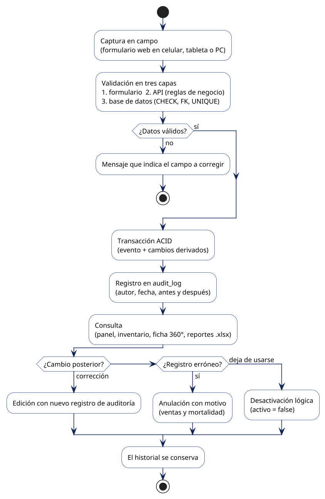
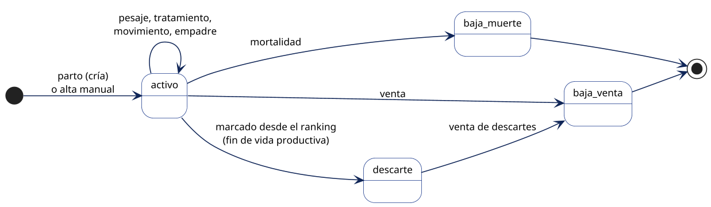
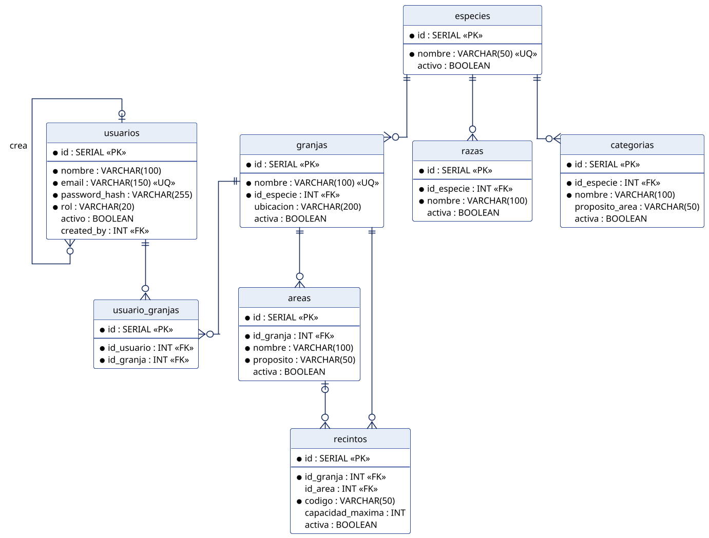
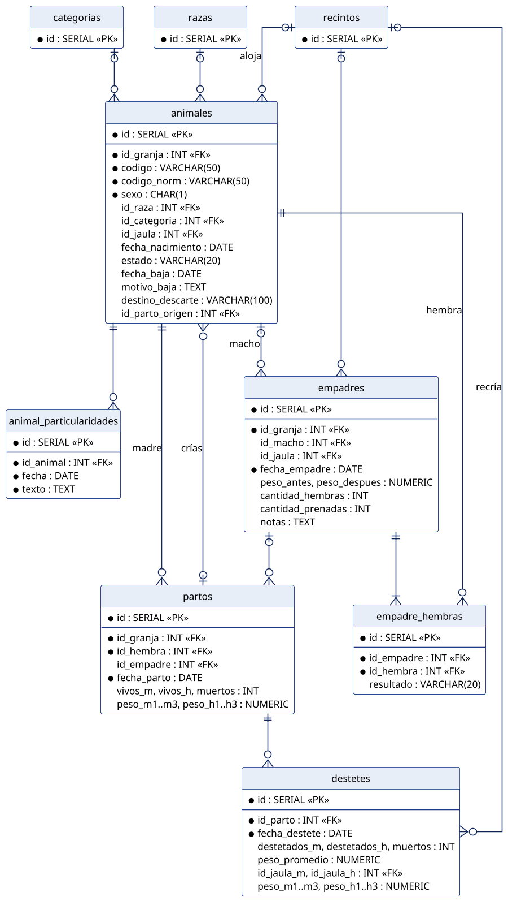
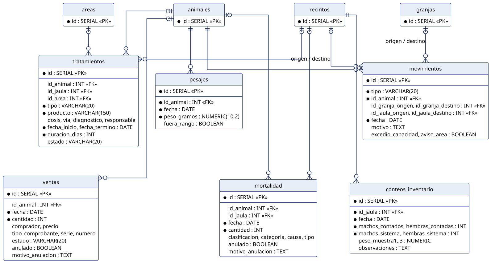
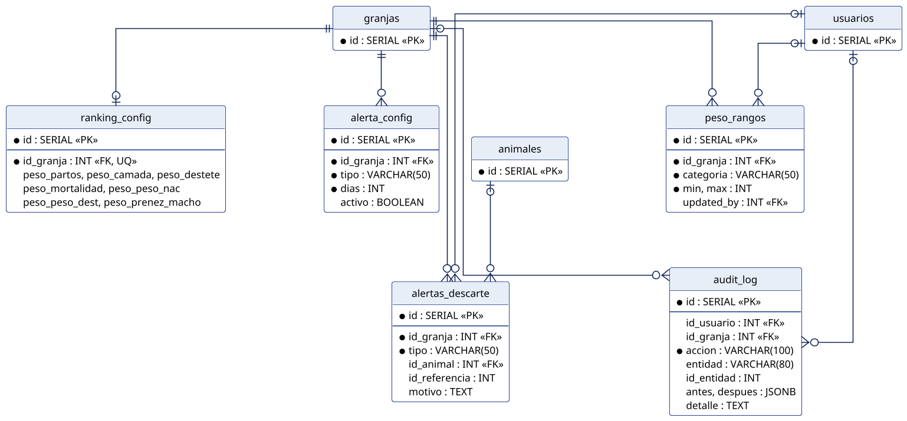

# Entregable 2 — Unidad II: Diseño de Datos

**Título:** Estrategia de Persistencia y Estructuras de Datos

**Objetivo:** Diseñar la estrategia de persistencia y las estructuras de datos de Cuy-System, seleccionando el modelo más adecuado al dominio del laboratorio de crianza de cuyes, dimensionando el almacenamiento y gestionando el ciclo de vida de los datos.

**Institución:** UNIVERSIDAD NACIONAL AGRARIA DE LA SELVA — FACULTAD DE INGENIERÍA EN INFORMÁTICA Y SISTEMAS
**Entorno de aplicación:** Laboratorio de crianza de cuyes — Facultad de Zootecnia (UNAS)

**Autores:**
- Dávila Isidro, Cristopher Leandro
- Guevara Cuchilla, Juan Alfredo
- Díaz Guzmán, Nicole Geraldine
- Vasquez Serafin, Nicol Angely
- Lopez Gonzales, Lourdes Xiomara

**Docente:** Acevedo Aliaga, Alberto Lucio · **Fecha:** Noviembre de 2026

> Nota de edición: este archivo es la fuente de la sección 4 del documento final. Mantener los nueve títulos `## N.`; el script de ensamblaje los reordena. El diccionario (sección 6) se regenera con `node tools/diccionario.mjs`.

---

## 1. Estrategia de persistencia

### 1.1. Tipo de almacenamiento elegido

Cuy-System guarda toda su información en una **base de datos relacional PostgreSQL**. Es el único almacén del sistema: no se usan archivos, servicios en la nube ni una segunda base de datos. Los reportes en Excel no se almacenan; se generan en el momento a partir de la base de datos y se entregan al usuario como descarga.

| Decisión | Elección | Motivo principal |
|------------------|----------------------|--------------------------------------------|
| Modelo de datos | Relacional (SQL) | Los datos del criadero están fuertemente relacionados: un parto depende de una madre y de un empadre; una venta da de baja a un animal que ocupa una jaula. |
| Motor | PostgreSQL | Transacciones ACID, restricciones de integridad (`FOREIGN KEY`, `CHECK`, `UNIQUE`), soporte de JSON (`JSONB`) y licencia libre. |
| Acceso desde la aplicación | Prisma ORM + SQL parametrizado (`pg`) | Prisma para operaciones simples con tipos verificados; SQL para consultas de agregación (inventario, reportes) y operaciones de varias tablas. |
| Instancias | Una base de datos para todas las granjas | El volumen es pequeño (ver *Dimensionamiento*) y el aislamiento se resuelve con la columna `id_granja`. |

### 1.2. Organización lógica de los datos

Las 25 tablas se agrupan igual que los módulos del backend, de modo que cada módulo es dueño de sus datos:

- **Seguridad y estructura** (`platform`): usuarios, granjas, áreas, jaulas (`recintos`) y los catálogos de especies, razas y categorías.
- **Animal y reproducción** (`platform` y `cuyes`): la ficha del animal y los eventos reproductivos (empadres, partos y destetes).
- **Eventos y salidas**: pesajes, tratamientos, movimientos, mortalidad, ventas y conteos de inventario.
- **Configuración y auditoría**: plazos de alertas, rangos de peso, ponderaciones del ranking y la bitácora de auditoría.

Todas las tablas operativas llevan la columna `id_granja`. El backend filtra cada consulta por la granja activa del usuario (cabecera `x-farm-id`), así que varias granjas comparten la misma base sin ver los datos de las demás.

### 1.3. Gestión del esquema

El esquema se define en un único archivo SQL (`backend/database/schema.sql`) escrito de forma **idempotente**: usa `CREATE TABLE IF NOT EXISTS` y `ADD COLUMN IF NOT EXISTS`, por lo que puede ejecutarse varias veces sin error. Así, instalar el sistema o actualizarlo a una versión nueva es el mismo comando (`npm run db:migrate`). El archivo `schema.prisma` refleja ese esquema para que el código acceda a las tablas con tipos verificados, y `npm run db:seed` carga los datos iniciales (usuarios base, la especie *cuyes*, sus razas y categorías). La aplicación no modifica el esquema mientras funciona: toda estructura (tablas, columnas, índices y claves foráneas) se declara únicamente en ese archivo.

## 2. Ciclo de vida de los datos

### 2.1. Flujo general

Todo dato del sistema recorre el mismo camino: se captura en un formulario, se valida en tres capas, se guarda dentro de una transacción junto con su registro de auditoría, se consulta en pantallas y reportes y, si deja de ser válido, se anula o desactiva en lugar de borrarse.



### 2.2. Creación

Un registro se crea de dos formas:

- **Alta directa:** el usuario registra un dato independiente, por ejemplo una jaula, un área o un animal comprado.
- **Alta derivada:** un evento crea o cambia otros registros en la misma transacción. Al registrar un **parto** se crea el parto y, por cada cría, un animal nuevo con `id_parto_origen` apuntando a ese parto (así queda su genealogía). Un **destete** ubica a las crías en sus jaulas de recría. Una **venta** o una **mortalidad** cambian el estado del animal. Si cualquier paso falla, la transacción se revierte completa y no quedan datos a medias.

### 2.3. Lectura

Las consultas siempre se limitan a la granja activa. Los mismos datos alimentan el panel de indicadores, el inventario (por área, por categoría y resumen mensual), la ficha 360° del animal con su pedigrí, la búsqueda global y los reportes en Excel. Ninguna cifra se guarda precalculada: el inventario se obtiene contando los animales activos y sumando los eventos del periodo, por lo que todas las pantallas muestran siempre el mismo número.

### 2.4. Actualización

Las ediciones guardan en la bitácora el estado anterior y el nuevo del registro. El cambio más importante es el **estado del animal**, que sigue el ciclo mostrado en la figura: todo animal nace o ingresa como `activo` y sale de la población por una de tres vías, registrando `fecha_baja` y el motivo.



### 2.5. Eliminación

Ningún dato de negocio se borra físicamente; así se conserva la trazabilidad que pide el laboratorio.

- **Desactivación** (`activo` o `activa` = falso): usuarios, granjas, áreas, jaulas, razas y categorías. El registro deja de aparecer en las listas, pero su historial sigue intacto y puede reactivarse.
- **Anulación** (`anulado` = verdadero más `motivo_anulacion`): ventas y mortalidad. El registro deja de contar en el inventario, pero queda visible como anulado.
- **Única eliminación física:** la tabla puente `usuario_granjas`, que se reemplaza al reasignar las granjas de un usuario. Solo guarda permisos, y el cambio queda registrado en la auditoría.

### 2.6. Operaciones por entidad y rol

C = crear, R = leer, U = actualizar, D = desactivar o anular. Todos los roles con acceso a la granja pueden leer.

| Entidad | C | R | U | D | Quién escribe |
|--------------------|----|----|----|----------|----------------------------------------|
| usuarios | ✓ | ✓ | ✓ | lógico | superadmin, admin |
| granjas | ✓ | ✓ | ✓ | lógico | superadmin |
| áreas y jaulas | ✓ | ✓ | ✓ | lógico | superadmin, admin, encargado |
| razas y categorías | ✓ | ✓ | — | lógico | superadmin, admin |
| animales | ✓ | ✓ | ✓ | por estado | superadmin, admin, encargado, auxiliar |
| empadres, partos, destetes | ✓ | ✓ | ✓ | — | superadmin, admin, encargado, auxiliar |
| pesajes, tratamientos | ✓ | ✓ | ✓ | — | incluye al supervisor |
| movimientos | ✓ | ✓ | — | — | encargado y auxiliar reubican; admin y supervisor trasladan entre granjas |
| mortalidad, ventas | ✓ | ✓ | — | anulación | registran: encargado, auxiliar; anulan: admin, supervisor, encargado |
| conteos de inventario | ✓ | ✓ | — | — | todos los roles operativos |
| configuración (alertas, rangos, ranking) | ✓ | ✓ | ✓ | — | superadmin, admin, supervisor |
| audit_log | ✓ | ✓ | — | — | solo el sistema (ningún usuario) |

## 3. Modelo entidad-relación

### 3.1. Diagrama entidad-relación

El modelo físico tiene **25 tablas**. Para que sea legible se presenta en cuatro vistas que coinciden con la organización lógica descrita en la estrategia de persistencia. En cada vista, las tablas de otras vistas aparecen reducidas a su clave. Por claridad se omiten las columnas de control (`created_by`, `created_at`, `updated_at`) y la relación de cada tabla operativa con `granjas` mediante `id_granja`; todas figuran en el diccionario de datos. Notación: `||` uno, `o|` cero o uno, `o{` cero o muchos.









### 3.2. Del modelo conceptual al modelo físico

El modelo conceptual del dominio (Entregable 1) describe el negocio; el físico lo implementa con algunos ajustes que evitan duplicar información:

| Concepto del dominio | Implementación física | Ajuste y motivo |
|--------------------|----------------------------|--------------------------------------------|
| CUY | `animales` | Se generaliza a cualquier especie; el código se normaliza en `codigo_norm` para evitar duplicados como `UM24` / `UM 24`. |
| RAZA, JAULA | `razas`, `recintos` (dentro de `areas`) | Se añade el nivel *área* para agrupar jaulas por propósito. |
| EMPADRE / DETALLE_EMPADRE | `empadres` / `empadre_hembras` | Igual al modelo; la hembra guarda su resultado (preñez, vacía, aborto). |
| PARTO, NACIMIENTO, CAMADA | `partos` + `animales.id_parto_origen` | Los tres conceptos describen el mismo evento: se fusionan en `partos`, y cada cría apunta a su parto (genealogía). |
| DESTETE | `destetes` | Se registra por camada (un destete por parto), no por cría. |
| MOVIMIENTO_JAULA | `movimientos` | Se amplía para traslados entre granjas (`tipo = transfer`). |
| PESO, SANIDAD | `pesajes`, `tratamientos` | Un pesaje por fila; el tratamiento puede aplicarse a un animal, una jaula o un área. |
| MORTALIDAD, VENTA | `mortalidad`, `ventas` | Admiten registro individual o por lote, y anulación con motivo. |
| DESCARTE | `animales.estado = 'descarte'` + `destino_descarte` | No necesita tabla propia: es un estado del animal con fecha y motivo. |
| SELECCION_REPRODUCTOR | ranking (`ranking_config`) + cambio de categoría a *reemplazo* | La selección se calcula con el ranking; el resultado se guarda en el animal y en la auditoría. |
| INVENTARIO | `conteos_inventario` | Guarda el conteo físico y lo registrado en ese momento; la diferencia se calcula al consultar. |

### 3.3. Integridad referencial

La base de datos —no solo la aplicación— impide datos inconsistentes mediante tres tipos de restricciones:

| Mecanismo | Dónde se aplica | Efecto |
|----------------------|------------------------------|--------------------------------------------|
| Claves foráneas (`FOREIGN KEY`) | Toda relación entre tablas | No se puede registrar un parto de una hembra inexistente ni un pesaje de un animal que no existe. |
| `ON DELETE CASCADE` | Dependientes puros: `usuario_granjas`, `areas`, `recintos`, `empadre_hembras`, `destetes`, `animal_particularidades` y configuración | Si se eliminara el registro padre, sus dependientes no quedan huérfanos. En la práctica no se borra (borrado lógico). |
| `ON DELETE SET NULL` | `recintos.id_area` | Si un área desaparece, sus jaulas quedan sin área en lugar de borrarse. |
| `UNIQUE` | `email`; código de animal por granja; nombre de área por granja; código de jaula por área; raza y categoría por especie; hembra por empadre | Evita duplicados que en Excel eran frecuentes. |
| `CHECK` | Rol, sexo (M/H), estado del animal, resultado de empadre, tipo de tratamiento y de movimiento; cantidades y pesos mayores que cero | Solo se aceptan valores del dominio. |

Las claves foráneas que se agregaron después de crear el esquema (jaulas de recría del destete, animal de una alerta ocultada y granja de la bitácora) se declaran `NOT VALID` y luego se validan: así la actualización no falla si existieran datos antiguos inconsistentes, y los registros nuevos siempre se controlan. La única referencia sin clave foránea es `alertas_descarte.id_referencia`, de forma intencional, porque puede apuntar a un empadre o a un parto.

Dos reglas de negocio requieren más que una restricción declarativa y se garantizan dentro de la transacción:

- **Comprobante único:** antes de registrar una venta se bloquea el comprobante (`pg_advisory_xact_lock`) y se verifica que ninguna venta no anulada lo haya usado. No puede ser un índice `UNIQUE`, porque una venta de descartes guarda una fila por animal con el mismo comprobante.
- **Una sola baja por animal:** la venta y la mortalidad solo cambian el estado de un animal que sigue en la población; si otro usuario ya lo dio de baja, la operación se revierte.

## 4. Normalización

### 4.1. Punto de partida: las planillas de Excel

La unidad registra cada reproductora en una hoja de Excel (planilla *Registro Individual de Cuyes*). El encabezado de la hoja tiene los datos de la hembra —**Código:** U01 · **Jaula:** "Jaula: 01" · **Raza:** Perú · **Particularidades:** "MURIO"— y debajo hay una fila por parto:

| Parto | Macho | Empadre | Nacimiento | Camada | Muertos | Pesos machos (g) | Pesos hembras (g) | Destete |
|-------|-------|---------|-----------|--------|--------|-----------|-----------|---------|
| 1 | M12 | 10/01/25 | 18/03/25 | 3 | 0 | 120, 115 | 110 | 02/04/25 |
| 2 | M12 | 05/04/25 | 11/06/25 | 2 | 1 | 125 | — | 26/06/25 |

Esta estructura tiene los problemas clásicos de una relación sin normalizar: celdas con varios valores ("120, 115"), texto mezclado con datos ("Jaula: 01"), una hoja distinta por hembra en lugar de una tabla común, y datos del macho y de la fecha de empadre que se repiten en las hojas de todas las hembras del mismo lote.

### 4.2. Primera forma normal (1FN)

*Regla: cada celda contiene un solo valor y no hay grupos repetidos.*

- Cada parto pasa a ser una fila de la tabla `partos`, en lugar de columnas repetidas en la hoja de la hembra.
- "Jaula: 01" se separa en una referencia a la jaula (`id_jaula`); las particularidades, que son varias notas fechadas, pasan a `animal_particularidades`.
- Las hembras de un empadre se registran una por fila en `empadre_hembras`.

### 4.3. Segunda forma normal (2FN)

*Regla: todo atributo depende de la clave completa.*

Si un parto se identificara por *(código de hembra, número de parto)*, la raza y la jaula dependerían solo de la hembra, no del parto. Por eso esos datos se trasladan a `animales`, y cada tabla usa una clave sustituta (`id`) con las referencias necesarias. En las tablas puente (`usuario_granjas`, `empadre_hembras`) los únicos atributos propios, como `resultado`, dependen de la pareja completa.

### 4.4. Tercera forma normal (3FN)

*Regla: ningún atributo depende de otro atributo que no sea la clave.*

- El macho y la fecha de empadre dependen del **empadre**, no del parto: se guardan en `empadres` y el parto solo referencia `id_empadre`.
- El nombre de la raza depende de la raza, y la especie de la raza depende de la raza: catálogos `razas`, `categorias` y `especies`.
- La edad, el total de la camada y la diferencia de un conteo se calculan a partir de otros campos, por lo que no se almacenan. Por ejemplo, la diferencia de `conteos_inventario` se obtiene restando lo registrado de lo contado.

### 4.5. Desnormalizaciones controladas

Algunos datos se guardan de forma redundante a propósito. Cada caso está justificado:

| Dato | Forma normal que relaja | Por qué se mantiene |
|--------------------|------------|----------------------------------------------|
| `peso_m1..m3`, `peso_h1..h3` en partos y destetes | 1FN (grupo repetido) | La plantilla oficial registra hasta tres crías por sexo; el seguimiento individual posterior se hace en `pesajes`. |
| `destetes.peso_promedio` | 3FN (dato derivado) | Se registra cuando no se pesan crías individuales. |
| `empadres.cantidad_hembras`, `cantidad_prenadas` | 3FN (derivable de `empadre_hembras`) | Copia al cierre del empadre que agiliza el ranking de machos. |
| `ventas` y `mortalidad`: `clasificacion`, `categoria` en texto | 3FN | Las bajas por lote no tienen un animal asociado y el texto conserva cómo se registró aunque el catálogo cambie. |
| `animales.codigo_norm` | 3FN (derivado de `codigo`) | Permite un índice único que impide duplicados con distinta escritura. |
| `tratamientos.fecha_termino` | 3FN (inicio + duración) | Permite consultar rápido los tratamientos en curso y sus alertas. |

`conteos_inventario.machos_sistema` y `hembras_sistema` no son redundancia: guardan lo que el sistema tenía **en ese momento**, un dato histórico que ya no podría recalcularse.

## 5. Modelo NoSQL (si aplica)

### 5.1. Aplicabilidad

No se utiliza una base de datos NoSQL. El núcleo del negocio exige relaciones obligatorias (madre–parto–crías, animal–jaula), transacciones que cambian varias tablas a la vez y reportes que cruzan datos. Un modelo de documentos tendría que duplicar esas relaciones dentro de cada documento y mantenerlas sincronizadas por código, justamente el problema que el sistema busca eliminar. La comparación completa está en *Justificación de la elección*.

### 5.2. Componente semiestructurado: la bitácora de auditoría

La única información sin estructura fija es la **copia del registro antes y después de cada cambio**, porque cada tabla tiene columnas distintas. Para ese caso se usa el tipo `JSONB` de PostgreSQL en `audit_log.antes` y `audit_log.despues`: cada fila guarda un documento JSON, como lo haría una base documental, pero dentro de la misma base relacional y de la misma transacción. Ejemplo de un registro al cambiar un animal de jaula:

```json
{
  "accion": "editar",
  "entidad": "animal",
  "id_entidad": 157,
  "antes":   { "codigo": "U101", "id_jaula": 20, "estado": "activo" },
  "despues": { "codigo": "U101", "id_jaula": 23, "estado": "activo" },
  "detalle": "Reubicación a jaula 23"
}
```

Este enfoque aporta la flexibilidad documental donde se necesita sin perder las ventajas del modelo relacional en el resto del sistema.

## 6. Diccionario de datos

### 6.1. Convenciones

- Nombres de tablas y columnas en español, en minúsculas y separados por guion bajo (`fecha_parto`).
- Clave primaria `id` autoincremental (`SERIAL`) en todas las tablas; las claves foráneas empiezan con `id_`.
- Fechas de eventos en `DATE`; fechas de control en `TIMESTAMP`; pesos en gramos con `NUMERIC(10,2)`.
- Columnas de control: `created_by` (autor), `created_at` y `updated_at`.
- Borrado lógico con `activo`/`activa` (catálogos y estructura) o `anulado` (ventas y mortalidad).

### 6.2. Tablas

<!-- diccionario:inicio -->

#### Seguridad y estructura

**`usuarios`** — Cuentas de acceso al sistema y su rol.

| Atributo | Tipo | Nulo | Clave | Restricción / defecto | Descripción |
|--------------------|---------------|------|-----------|-------------------|--------------------------|
| `id` | SERIAL | No | PK | — | Identificador interno autoincremental. |
| `nombre` | VARCHAR(100) | No | — | — | Nombre visible. |
| `email` | VARCHAR(150) | No | — | Único | Correo de inicio de sesión (único). |
| `password_hash` | VARCHAR(255) | No | — | — | Contraseña cifrada con bcrypt; nunca se guarda en texto plano. |
| `rol` | VARCHAR(20) | No | — | Valores: superadmin, admin, encargado, supervisor, auxiliar | Rol que determina los permisos. |
| `activo` | BOOLEAN | Sí | — | Defecto: true | Falso si fue dado de baja (borrado lógico). |
| `created_by` | INTEGER | Sí | FK → usuarios | — | Usuario que creó la cuenta. |
| `created_at` | TIMESTAMP | Sí | — | Defecto: fecha y hora actual | Fecha y hora de creación. |
| `updated_at` | TIMESTAMP | Sí | — | Defecto: fecha y hora actual | Fecha y hora de la última modificación. |

**`usuario_granjas`** — Granjas en las que puede operar cada usuario (relación N:M).

| Atributo | Tipo | Nulo | Clave | Restricción / defecto | Descripción |
|--------------------|---------------|------|-----------|-------------------|--------------------------|
| `id` | SERIAL | No | PK | — | Identificador interno autoincremental. |
| `id_usuario` | INTEGER | No | FK → usuarios | Borra en cascada | Usuario autorizado. |
| `id_granja` | INTEGER | No | FK → granjas | Borra en cascada | Granja a la que tiene acceso. |

Unicidad compuesta: (`id_usuario`, `id_granja`).

**`especies`** — Especies que maneja la plataforma (catálogo raíz).

| Atributo | Tipo | Nulo | Clave | Restricción / defecto | Descripción |
|--------------------|---------------|------|-----------|-------------------|--------------------------|
| `id` | SERIAL | No | PK | — | Identificador interno autoincremental. |
| `nombre` | VARCHAR(50) | No | — | Único | Nombre visible. |
| `activo` | BOOLEAN | Sí | — | Defecto: true | Falso si fue dado de baja (borrado lógico). |

**`granjas`** — Unidades de crianza; cada una pertenece a una especie.

| Atributo | Tipo | Nulo | Clave | Restricción / defecto | Descripción |
|--------------------|---------------|------|-----------|-------------------|--------------------------|
| `id` | SERIAL | No | PK | — | Identificador interno autoincremental. |
| `nombre` | VARCHAR(100) | No | — | Único | Nombre visible. |
| `id_especie` | INTEGER | No | FK → especies | — | Especie que se cría en la granja. |
| `ubicacion` | VARCHAR(200) | Sí | — | — | Ubicación física de la granja. |
| `activa` | BOOLEAN | Sí | — | Defecto: true | Falso si fue dada de baja (borrado lógico). |
| `created_at` | TIMESTAMP | Sí | — | Defecto: fecha y hora actual | Fecha y hora de creación. |
| `updated_at` | TIMESTAMP | Sí | — | Defecto: fecha y hora actual | Fecha y hora de la última modificación. |

**`areas`** — Agrupaciones de jaulas dentro de una granja según su propósito.

| Atributo | Tipo | Nulo | Clave | Restricción / defecto | Descripción |
|--------------------|---------------|------|-----------|-------------------|--------------------------|
| `id` | SERIAL | No | PK | — | Identificador interno autoincremental. |
| `id_granja` | INTEGER | No | FK → granjas | Borra en cascada | Granja a la que pertenece el registro. |
| `nombre` | VARCHAR(100) | No | — | — | Nombre visible. |
| `proposito` | VARCHAR(50) | No | — | — | Uso del área (maternidad, recría, engorde, empadre…). |
| `activa` | BOOLEAN | Sí | — | Defecto: true | Falso si fue dada de baja (borrado lógico). |
| `created_at` | TIMESTAMP | Sí | — | Defecto: fecha y hora actual | Fecha y hora de creación. |
| `updated_at` | TIMESTAMP | Sí | — | Defecto: fecha y hora actual | Fecha y hora de la última modificación. |

Unicidad compuesta: (`id_granja`, `nombre`).

**`recintos`** — Jaulas o pozas donde se alojan los animales.

| Atributo | Tipo | Nulo | Clave | Restricción / defecto | Descripción |
|--------------------|---------------|------|-----------|-------------------|--------------------------|
| `id` | SERIAL | No | PK | — | Identificador interno autoincremental. |
| `id_area` | INTEGER | Sí | FK → areas | Queda nulo al borrar | Área a la que pertenece la jaula (opcional). |
| `codigo` | VARCHAR(50) | No | — | — | Código visible de la jaula, único dentro del área. |
| `capacidad_maxima` | INTEGER | Sí | — | — | Animales que admite; superarla exige confirmación. |
| `activa` | BOOLEAN | Sí | — | Defecto: true | Falso si fue dada de baja (borrado lógico). |
| `created_at` | TIMESTAMP | Sí | — | Defecto: fecha y hora actual | Fecha y hora de creación. |
| `updated_at` | TIMESTAMP | Sí | — | Defecto: fecha y hora actual | Fecha y hora de la última modificación. |
| `id_granja` | INTEGER | No | FK → granjas | Borra en cascada | Granja a la que pertenece el registro. |

Unicidad compuesta: (`id_area`, `codigo`).

**`razas`** — Catálogo de razas o líneas genéticas por especie.

| Atributo | Tipo | Nulo | Clave | Restricción / defecto | Descripción |
|--------------------|---------------|------|-----------|-------------------|--------------------------|
| `id` | SERIAL | No | PK | — | Identificador interno autoincremental. |
| `id_especie` | INTEGER | No | FK → especies | — | Especie a la que pertenece. |
| `nombre` | VARCHAR(100) | No | — | — | Nombre visible. |
| `activa` | BOOLEAN | Sí | — | Defecto: true | Falso si fue dada de baja (borrado lógico). |

Unicidad compuesta: (`id_especie`, `nombre`).

**`categorias`** — Catálogo de etapas o categorías productivas por especie.

| Atributo | Tipo | Nulo | Clave | Restricción / defecto | Descripción |
|--------------------|---------------|------|-----------|-------------------|--------------------------|
| `id` | SERIAL | No | PK | — | Identificador interno autoincremental. |
| `id_especie` | INTEGER | No | FK → especies | — | Especie a la que pertenece. |
| `nombre` | VARCHAR(100) | No | — | — | Nombre visible. |
| `proposito_area` | VARCHAR(50) | Sí | — | — | Propósito de área donde debe ubicarse esta categoría. |
| `activa` | BOOLEAN | Sí | — | Defecto: true | Falso si fue dada de baja (borrado lógico). |

Unicidad compuesta: (`id_especie`, `nombre`).

#### Animal y reproducción

**`animales`** — Ficha individual de cada animal: identidad, ubicación, estado y origen.

| Atributo | Tipo | Nulo | Clave | Restricción / defecto | Descripción |
|--------------------|---------------|------|-----------|-------------------|--------------------------|
| `id` | SERIAL | No | PK | — | Identificador interno autoincremental. |
| `id_granja` | INTEGER | No | FK → granjas | — | Granja a la que pertenece el registro. |
| `codigo` | VARCHAR(50) | No | — | — | Código del animal tal como se escribió. |
| `codigo_norm` | VARCHAR(50) | No | — | — | Código normalizado (mayúsculas, sin espacios) para búsqueda y unicidad. |
| `sexo` | CHAR(1) | No | — | Valores: M, H | M = macho, H = hembra. |
| `id_raza` | INTEGER | Sí | FK → razas | — | Raza del animal. |
| `id_categoria` | INTEGER | Sí | FK → categorias | — | Categoría productiva actual. |
| `id_jaula` | INTEGER | Sí | FK → recintos | — | Jaula donde se encuentra. |
| `fecha_nacimiento` | DATE | Sí | — | — | Fecha de nacimiento. |
| `estado` | VARCHAR(20) | Sí | — | Valores: activo, baja_muerte, baja_venta, descarte; Defecto: 'activo' | Situación del animal en la población. |
| `fecha_baja` | DATE | Sí | — | — | Fecha en que salió de la población activa. |
| `motivo_baja` | TEXT | Sí | — | — | Causa de la baja. |
| `created_by` | INTEGER | Sí | FK → usuarios | — | Usuario que creó el registro. |
| `created_at` | TIMESTAMP | Sí | — | Defecto: fecha y hora actual | Fecha y hora de creación. |
| `updated_at` | TIMESTAMP | Sí | — | Defecto: fecha y hora actual | Fecha y hora de la última modificación. |
| `id_parto_origen` | INTEGER | Sí | FK → partos | — | Parto en el que nació (genealogía: madre y empadre). |
| `destino_descarte` | VARCHAR(100) | Sí | — | — | Destino del animal descartado (venta, consumo…). |

Unicidad compuesta: (`id_granja`, `codigo_norm`).

**`animal_particularidades`** — Notas fechadas sobre un animal (rasgos, eventos, observaciones).

| Atributo | Tipo | Nulo | Clave | Restricción / defecto | Descripción |
|--------------------|---------------|------|-----------|-------------------|--------------------------|
| `id` | SERIAL | No | PK | — | Identificador interno autoincremental. |
| `id_animal` | INTEGER | No | FK → animales | Borra en cascada | Animal involucrado. |
| `fecha` | DATE | No | — | Defecto: fecha actual | Fecha de la nota. |
| `texto` | TEXT | No | — | — | Contenido de la nota. |
| `created_by` | INTEGER | Sí | FK → usuarios | — | Usuario que creó el registro. |
| `created_at` | TIMESTAMP | Sí | — | Defecto: fecha y hora actual | Fecha y hora de creación. |

**`empadres`** — Lote de apareamiento de un macho en una jaula.

| Atributo | Tipo | Nulo | Clave | Restricción / defecto | Descripción |
|--------------------|---------------|------|-----------|-------------------|--------------------------|
| `id` | SERIAL | No | PK | — | Identificador interno autoincremental. |
| `id_granja` | INTEGER | No | FK → granjas | — | Granja a la que pertenece el registro. |
| `id_macho` | INTEGER | Sí | FK → animales | — | Macho reproductor del lote. |
| `id_jaula` | INTEGER | Sí | FK → recintos | — | Jaula del empadre. |
| `fecha_empadre` | DATE | No | — | — | Inicio del empadre; base para proyectar el parto (+67 días). |
| `peso_antes` | NUMERIC(10,2) | Sí | — | — | Peso del macho al iniciar (g). |
| `peso_despues` | NUMERIC(10,2) | Sí | — | — | Peso del macho al cerrar (g). |
| `cantidad_hembras` | INTEGER | Sí | — | — | Hembras del lote al cerrar (copia para el ranking). |
| `cantidad_prenadas` | INTEGER | Sí | — | — | Hembras preñadas al cerrar (copia para el ranking). |
| `notas` | TEXT | Sí | — | — | Comentarios del empadre. |
| `created_by` | INTEGER | Sí | FK → usuarios | — | Usuario que creó el registro. |
| `created_at` | TIMESTAMP | Sí | — | Defecto: fecha y hora actual | Fecha y hora de creación. |
| `updated_at` | TIMESTAMP | Sí | — | Defecto: fecha y hora actual | Fecha y hora de la última modificación. |

**`empadre_hembras`** — Hembras que participan en cada empadre y su resultado.

| Atributo | Tipo | Nulo | Clave | Restricción / defecto | Descripción |
|--------------------|---------------|------|-----------|-------------------|--------------------------|
| `id` | SERIAL | No | PK | — | Identificador interno autoincremental. |
| `id_empadre` | INTEGER | No | FK → empadres | Borra en cascada | Empadre al que pertenece. |
| `id_hembra` | INTEGER | No | FK → animales | — | Hembra participante. |
| `resultado` | VARCHAR(20) | Sí | — | Valores: abierto, prenez, vacia, aborto, murio; Defecto: 'abierto' | Resultado reproductivo de la hembra en el lote. |

Unicidad compuesta: (`id_empadre`, `id_hembra`).

**`partos`** — Parto de una hembra con la camada nacida.

| Atributo | Tipo | Nulo | Clave | Restricción / defecto | Descripción |
|--------------------|---------------|------|-----------|-------------------|--------------------------|
| `id` | SERIAL | No | PK | — | Identificador interno autoincremental. |
| `id_granja` | INTEGER | No | FK → granjas | — | Granja a la que pertenece el registro. |
| `id_hembra` | INTEGER | No | FK → animales | — | Madre. |
| `id_empadre` | INTEGER | Sí | FK → empadres | — | Empadre que originó el parto (padre). |
| `fecha_parto` | DATE | No | — | — | Fecha del parto. |
| `vivos_m` | INTEGER | Sí | — | Defecto: 0 | Crías macho nacidas vivas. |
| `vivos_h` | INTEGER | Sí | — | Defecto: 0 | Crías hembra nacidas vivas. |
| `muertos` | INTEGER | Sí | — | Defecto: 0 | Crías nacidas muertas. |
| `peso_m1` | NUMERIC(10,2) | Sí | — | — | Peso de la cría macho 1 (g). |
| `peso_m2` | NUMERIC(10,2) | Sí | — | — | Peso de la cría macho 2 (g). |
| `peso_m3` | NUMERIC(10,2) | Sí | — | — | Peso de la cría macho 3 (g). |
| `peso_h1` | NUMERIC(10,2) | Sí | — | — | Peso de la cría hembra 1 (g). |
| `peso_h2` | NUMERIC(10,2) | Sí | — | — | Peso de la cría hembra 2 (g). |
| `peso_h3` | NUMERIC(10,2) | Sí | — | — | Peso de la cría hembra 3 (g). |
| `created_by` | INTEGER | Sí | FK → usuarios | — | Usuario que creó el registro. |
| `created_at` | TIMESTAMP | Sí | — | Defecto: fecha y hora actual | Fecha y hora de creación. |
| `updated_at` | TIMESTAMP | Sí | — | Defecto: fecha y hora actual | Fecha y hora de la última modificación. |

**`destetes`** — Destete de la camada de un parto.

| Atributo | Tipo | Nulo | Clave | Restricción / defecto | Descripción |
|--------------------|---------------|------|-----------|-------------------|--------------------------|
| `id` | SERIAL | No | PK | — | Identificador interno autoincremental. |
| `id_parto` | INTEGER | No | FK → partos | Borra en cascada | Parto cuya camada se desteta. |
| `fecha_destete` | DATE | No | — | — | Fecha del destete. |
| `destetados_m` | INTEGER | Sí | — | Defecto: 0 | Machos destetados. |
| `destetados_h` | INTEGER | Sí | — | Defecto: 0 | Hembras destetadas. |
| `muertos` | INTEGER | Sí | — | Defecto: 0 | Crías muertas antes del destete. |
| `peso_m1` | NUMERIC(10,2) | Sí | — | — | Peso de la cría macho 1 (g). |
| `peso_m2` | NUMERIC(10,2) | Sí | — | — | Peso de la cría macho 2 (g). |
| `peso_m3` | NUMERIC(10,2) | Sí | — | — | Peso de la cría macho 3 (g). |
| `peso_h1` | NUMERIC(10,2) | Sí | — | — | Peso de la cría hembra 1 (g). |
| `peso_h2` | NUMERIC(10,2) | Sí | — | — | Peso de la cría hembra 2 (g). |
| `peso_h3` | NUMERIC(10,2) | Sí | — | — | Peso de la cría hembra 3 (g). |
| `created_by` | INTEGER | Sí | FK → usuarios | — | Usuario que creó el registro. |
| `created_at` | TIMESTAMP | Sí | — | Defecto: fecha y hora actual | Fecha y hora de creación. |
| `peso_promedio` | NUMERIC(10,2) | Sí | — | — | Peso promedio de la camada (g). |
| `id_jaula_m` | INTEGER | Sí | FK → recintos | — | Jaula de recría de los machos. |
| `id_jaula_h` | INTEGER | Sí | FK → recintos | — | Jaula de recría de las hembras. |

#### Eventos y salidas

**`pesajes`** — Controles de peso individuales.

| Atributo | Tipo | Nulo | Clave | Restricción / defecto | Descripción |
|--------------------|---------------|------|-----------|-------------------|--------------------------|
| `id` | SERIAL | No | PK | — | Identificador interno autoincremental. |
| `id_granja` | INTEGER | No | FK → granjas | — | Granja a la que pertenece el registro. |
| `id_animal` | INTEGER | No | FK → animales | — | Animal involucrado. |
| `fecha` | DATE | No | — | — | Fecha del evento. |
| `peso_gramos` | NUMERIC(10,2) | No | — | > 0 | Peso registrado en gramos. |
| `fuera_rango` | BOOLEAN | Sí | — | Defecto: false | Verdadero si quedó fuera del rango de su categoría (se confirmó). |
| `created_by` | INTEGER | Sí | FK → usuarios | — | Usuario que creó el registro. |
| `created_at` | TIMESTAMP | Sí | — | Defecto: fecha y hora actual | Fecha y hora de creación. |

**`tratamientos`** — Tratamientos sanitarios a un animal, jaula o área.

| Atributo | Tipo | Nulo | Clave | Restricción / defecto | Descripción |
|--------------------|---------------|------|-----------|-------------------|--------------------------|
| `id` | SERIAL | No | PK | — | Identificador interno autoincremental. |
| `id_granja` | INTEGER | No | FK → granjas | — | Granja a la que pertenece el registro. |
| `id_animal` | INTEGER | Sí | FK → animales | — | Animal tratado (si es individual). |
| `id_jaula` | INTEGER | Sí | FK → recintos | — | Jaula tratada (si es colectivo). |
| `id_area` | INTEGER | Sí | FK → areas | — | Área tratada (si es colectivo). |
| `tipo` | VARCHAR(20) | No | — | Valores: preventivo, curativo | Preventivo o curativo. |
| `producto` | VARCHAR(150) | No | — | — | Medicamento o producto aplicado. |
| `dosis` | VARCHAR(100) | Sí | — | — | Dosis aplicada. |
| `via` | VARCHAR(50) | Sí | — | — | Vía de administración. |
| `fecha_inicio` | DATE | No | — | — | Inicio del tratamiento. |
| `duracion_dias` | INTEGER | No | — | > 0 | Duración en días. |
| `fecha_termino` | DATE | No | — | — | Fin previsto (inicio + duración). |
| `diagnostico` | TEXT | Sí | — | — | Diagnóstico que motivó el tratamiento. |
| `responsable` | VARCHAR(100) | Sí | — | — | Persona que lo indicó o aplicó. |
| `estado` | VARCHAR(20) | Sí | — | Valores: en_curso, terminado; Defecto: 'en_curso' | En curso o terminado. |
| `motivo_cierre` | TEXT | Sí | — | — | Observación al finalizar. |
| `created_by` | INTEGER | Sí | FK → usuarios | — | Usuario que creó el registro. |
| `created_at` | TIMESTAMP | Sí | — | Defecto: fecha y hora actual | Fecha y hora de creación. |

**`movimientos`** — Traslados de animales entre jaulas o entre granjas.

| Atributo | Tipo | Nulo | Clave | Restricción / defecto | Descripción |
|--------------------|---------------|------|-----------|-------------------|--------------------------|
| `id` | SERIAL | No | PK | — | Identificador interno autoincremental. |
| `tipo` | VARCHAR(20) | No | — | Valores: traslado, transferencia | relocate = dentro de la granja; transfer = a otra granja. |
| `id_animal` | INTEGER | No | FK → animales | — | Animal involucrado. |
| `id_granja_origen` | INTEGER | Sí | FK → granjas | — | Granja de origen. |
| `id_granja_destino` | INTEGER | Sí | FK → granjas | — | Granja de destino. |
| `id_jaula_origen` | INTEGER | Sí | FK → recintos | — | Jaula de origen. |
| `id_jaula_destino` | INTEGER | Sí | FK → recintos | — | Jaula de destino. |
| `fecha` | DATE | No | — | — | Fecha del evento. |
| `motivo` | TEXT | Sí | — | — | Motivo del traslado. |
| `excedio_capacidad` | BOOLEAN | Sí | — | Defecto: false | Verdadero si se confirmó un sobrecupo. |
| `aviso_area` | BOOLEAN | Sí | — | Defecto: false | Verdadero si el animal quedó fuera del área de su categoría. |
| `created_by` | INTEGER | Sí | FK → usuarios | — | Usuario que creó el registro. |
| `created_at` | TIMESTAMP | Sí | — | Defecto: fecha y hora actual | Fecha y hora de creación. |

**`mortalidad`** — Bajas por muerte (individuales o por lote).

| Atributo | Tipo | Nulo | Clave | Restricción / defecto | Descripción |
|--------------------|---------------|------|-----------|-------------------|--------------------------|
| `id` | SERIAL | No | PK | — | Identificador interno autoincremental. |
| `id_granja` | INTEGER | No | FK → granjas | — | Granja a la que pertenece el registro. |
| `id_animal` | INTEGER | Sí | FK → animales | — | Animal fallecido (vacío si es un lote). |
| `fecha` | DATE | No | — | — | Fecha del evento. |
| `clasificacion` | VARCHAR(50) | Sí | — | — | Clasificación del lote (raza o grupo) tal como se registró. |
| `categoria` | VARCHAR(50) | Sí | — | — | Categoría productiva tal como se registró (texto histórico). |
| `cantidad` | INTEGER | No | — | > 0 | Número de animales del registro. |
| `causa` | TEXT | Sí | — | — | Causa probable de la muerte. |
| `id_jaula` | INTEGER | Sí | FK → recintos | — | Jaula donde ocurrió. |
| `created_by` | INTEGER | Sí | FK → usuarios | — | Usuario que creó el registro. |
| `created_at` | TIMESTAMP | Sí | — | Defecto: fecha y hora actual | Fecha y hora de creación. |
| `tipo` | VARCHAR(20) | Sí | — | Defecto: 'general' | Tipo de baja (general, perinatal, destete…). |
| `observaciones` | TEXT | Sí | — | — | Comentarios libres. |
| `anulado` | BOOLEAN | Sí | — | Defecto: false | Verdadero si el registro fue anulado (no cuenta en los cálculos). |
| `motivo_anulacion` | TEXT | Sí | — | — | Justificación de la anulación. |

**`ventas`** — Salidas comerciales respaldadas por comprobante.

| Atributo | Tipo | Nulo | Clave | Restricción / defecto | Descripción |
|--------------------|---------------|------|-----------|-------------------|--------------------------|
| `id` | SERIAL | No | PK | — | Identificador interno autoincremental. |
| `id_granja` | INTEGER | No | FK → granjas | — | Granja a la que pertenece el registro. |
| `id_animal` | INTEGER | Sí | FK → animales | — | Animal vendido (vacío si es un lote). |
| `fecha` | DATE | No | — | — | Fecha del evento. |
| `clasificacion` | VARCHAR(50) | Sí | — | — | Clasificación del lote (raza o grupo) tal como se registró. |
| `categoria` | VARCHAR(50) | Sí | — | — | Categoría productiva tal como se registró (texto histórico). |
| `cantidad` | INTEGER | No | — | > 0 | Número de animales del registro. |
| `comprador` | VARCHAR(100) | Sí | — | — | Nombre del comprador. |
| `precio` | NUMERIC(10,2) | Sí | — | — | Importe total (S/). |
| `created_by` | INTEGER | Sí | FK → usuarios | — | Usuario que creó el registro. |
| `created_at` | TIMESTAMP | Sí | — | Defecto: fecha y hora actual | Fecha y hora de creación. |
| `tipo_comprobante` | VARCHAR(20) | Sí | — | — | Tipo de comprobante emitido por la caja UNAS. |
| `serie` | VARCHAR(10) | Sí | — | — | Serie del comprobante. |
| `numero` | VARCHAR(20) | Sí | — | — | Número del comprobante. |
| `observaciones` | TEXT | Sí | — | — | Comentarios libres. |
| `estado` | VARCHAR(20) | Sí | — | Defecto: 'registrada' | Estado de la venta. |
| `anulado` | BOOLEAN | Sí | — | Defecto: false | Verdadero si el registro fue anulado (no cuenta en los cálculos). |
| `motivo_anulacion` | TEXT | Sí | — | — | Justificación de la anulación. |

**`conteos_inventario`** — Conteos físicos de jaulas conciliados con lo registrado (CU-06).

| Atributo | Tipo | Nulo | Clave | Restricción / defecto | Descripción |
|--------------------|---------------|------|-----------|-------------------|--------------------------|
| `id` | SERIAL | No | PK | — | Identificador interno autoincremental. |
| `id_granja` | INTEGER | No | FK → granjas | — | Granja a la que pertenece el registro. |
| `id_jaula` | INTEGER | No | FK → recintos | — | Jaula contada. |
| `fecha` | DATE | No | — | — | Fecha del conteo. |
| `machos_contados` | INTEGER | No | — | ≥ 0 | Machos contados físicamente. |
| `hembras_contadas` | INTEGER | No | — | ≥ 0 | Hembras contadas físicamente. |
| `machos_sistema` | INTEGER | No | — | ≥ 0 | Machos registrados en el sistema al momento del conteo. |
| `hembras_sistema` | INTEGER | No | — | ≥ 0 | Hembras registradas en el sistema al momento del conteo. |
| `peso_muestra1` | NUMERIC(10,2) | Sí | — | > 0 | Peso de la muestra 1 (g). |
| `peso_muestra2` | NUMERIC(10,2) | Sí | — | > 0 | Peso de la muestra 2 (g). |
| `peso_muestra3` | NUMERIC(10,2) | Sí | — | > 0 | Peso de la muestra 3 (g). |
| `observaciones` | TEXT | Sí | — | — | Causa probable de la diferencia (obligatoria si faltan animales). |
| `created_by` | INTEGER | Sí | FK → usuarios | — | Usuario que creó el registro. |
| `created_at` | TIMESTAMP | Sí | — | Defecto: fecha y hora actual | Fecha y hora de creación. |

#### Configuración y auditoría

**`alerta_config`** — Plazos en días que disparan cada tipo de alerta, por granja.

| Atributo | Tipo | Nulo | Clave | Restricción / defecto | Descripción |
|--------------------|---------------|------|-----------|-------------------|--------------------------|
| `id` | SERIAL | No | PK | — | Identificador interno autoincremental. |
| `id_granja` | INTEGER | No | FK → granjas | Borra en cascada | Granja a la que pertenece el registro. |
| `tipo` | VARCHAR(50) | No | — | — | Tipo de alerta (parto, destete, pesaje…). |
| `dias` | INTEGER | No | — | Defecto: 0 | Días que deben pasar para disparar la alerta. |
| `activo` | BOOLEAN | Sí | — | Defecto: true | Si la alerta está habilitada. |

Unicidad compuesta: (`id_granja`, `tipo`).

**`peso_rangos`** — Rango de peso esperado por categoría, por granja.

| Atributo | Tipo | Nulo | Clave | Restricción / defecto | Descripción |
|--------------------|---------------|------|-----------|-------------------|--------------------------|
| `id` | SERIAL | No | PK | — | Identificador interno autoincremental. |
| `id_granja` | INTEGER | No | FK → granjas | Borra en cascada | Granja a la que pertenece el registro. |
| `categoria` | VARCHAR(50) | No | — | — | Categoría a la que aplica el rango. |
| `min` | INTEGER | No | — | — | Peso mínimo esperado (g). |
| `max` | INTEGER | No | — | — | Peso máximo esperado (g). |
| `updated_by` | INTEGER | Sí | FK → usuarios | — | Usuario que actualizó el rango. |
| `updated_at` | TIMESTAMP | Sí | — | Defecto: fecha y hora actual | Fecha y hora de la última modificación. |

Unicidad compuesta: (`id_granja`, `categoria`).

**`ranking_config`** — Ponderaciones del ranking de reproductores, por granja.

| Atributo | Tipo | Nulo | Clave | Restricción / defecto | Descripción |
|--------------------|---------------|------|-----------|-------------------|--------------------------|
| `id` | SERIAL | No | PK | — | Identificador interno autoincremental. |
| `id_granja` | INTEGER | No | FK → granjas | Único; Borra en cascada | Granja a la que pertenece el registro. |
| `peso_partos` | NUMERIC(6,2) | Sí | — | Defecto: 20 | Ponderación del número de partos (%). |
| `peso_camada` | NUMERIC(6,2) | Sí | — | Defecto: 25 | Ponderación del tamaño de camada (%). |
| `peso_destete` | NUMERIC(6,2) | Sí | — | Defecto: 20 | Ponderación de crías destetadas (%). |
| `peso_mortalidad` | NUMERIC(6,2) | Sí | — | Defecto: 15 | Ponderación de la mortalidad de crías (%). |
| `peso_peso_nac` | NUMERIC(6,2) | Sí | — | Defecto: 10 | Ponderación del peso al nacer (%). |
| `peso_peso_dest` | NUMERIC(6,2) | Sí | — | Defecto: 10 | Ponderación del peso al destete (%). |
| `peso_prenez_macho` | NUMERIC(6,2) | Sí | — | Defecto: 30 | Ponderación de la tasa de preñez del macho (%). |
| `updated_at` | TIMESTAMP | Sí | — | Defecto: fecha y hora actual | Fecha y hora de la última modificación. |

**`alertas_descarte`** — Alertas que un usuario ocultó del panel (descartadas) y por qué.

| Atributo | Tipo | Nulo | Clave | Restricción / defecto | Descripción |
|--------------------|---------------|------|-----------|-------------------|--------------------------|
| `id` | SERIAL | No | PK | — | Identificador interno autoincremental. |
| `id_granja` | INTEGER | No | FK → granjas | — | Granja a la que pertenece el registro. |
| `tipo` | VARCHAR(50) | No | — | — | Tipo de alerta ocultada. |
| `id_animal` | INTEGER | Sí | FK → animales | — | Animal al que se refería la alerta. |
| `id_referencia` | INTEGER | Sí | — | — | Registro que originó la alerta (empadre, parto…). |
| `motivo` | TEXT | Sí | — | — | Por qué se ocultó. |
| `created_by` | INTEGER | Sí | FK → usuarios | — | Usuario que creó el registro. |
| `created_at` | TIMESTAMP | Sí | — | Defecto: fecha y hora actual | Fecha y hora de creación. |

**`audit_log`** — Bitácora de auditoría de todas las operaciones de escritura.

| Atributo | Tipo | Nulo | Clave | Restricción / defecto | Descripción |
|--------------------|---------------|------|-----------|-------------------|--------------------------|
| `id` | SERIAL | No | PK | — | Identificador interno autoincremental. |
| `id_usuario` | INTEGER | Sí | FK → usuarios | — | Usuario que realizó la acción. |
| `accion` | VARCHAR(100) | No | — | — | Acción (crear, editar, anular, login…). |
| `detalle` | TEXT | Sí | — | — | Resumen legible de la operación. |
| `created_at` | TIMESTAMP | Sí | — | Defecto: fecha y hora actual | Fecha y hora de creación. |
| `entidad` | VARCHAR(80) | Sí | — | — | Tipo de registro afectado. |
| `id_entidad` | INTEGER | Sí | — | — | Identificador del registro afectado. |
| `id_granja` | INTEGER | Sí | FK → granjas | — | Granja donde ocurrió. |
| `antes` | JSONB | Sí | — | — | Copia del registro antes del cambio (JSONB). |
| `despues` | JSONB | Sí | — | — | Copia del registro después del cambio (JSONB). |

<!-- diccionario:fin -->

## 7. Dimensionamiento

### 7.1. Línea base: datos reales de la unidad

El dimensionamiento parte de los registros de la propia unidad (planillas de inventario e individuales):

| Indicador | 2025 | 2026 (enero–julio) |
|------------------------------|------------|--------------------|
| Nacimientos | 929 | 949 (≈ 1 630 proyectados al año) |
| Bajas por mortalidad | 352 | 238 |
| Ventas (animales) | 327 | 633 |
| Población al cierre | 494 | 572 (a julio) |
| Reproductoras / reproductores | ≈ 245 / ≈ 43 | — |
| Histórico en planillas | 396 fichas de hembras y 806 partos | — |

### 7.2. Estimación por tabla (una granja, por año)

Supuestos: 1 630 nacimientos al año, camadas de 2,5 crías en promedio (≈ 650 partos), pesaje mensual de la población (≈ 500 animales), unos tres traslados por animal, conteo mensual de 95 jaulas y auditoría de cada operación de escritura. El tamaño por fila incluye la cabecera de PostgreSQL (≈ 24 bytes).

| Tabla | Registros / año | Tamaño por fila | Volumen / año |
|--------------------|------------|----------|----------|
| animales | 1 630 | 180 B | 0,29 MB |
| partos | 650 | 140 B | 0,09 MB |
| destetes | 650 | 140 B | 0,09 MB |
| empadres / empadre_hembras | 110 / 650 | 110 B / 50 B | 0,04 MB |
| pesajes | 6 000 | 70 B | 0,42 MB |
| movimientos | 5 000 | 110 B | 0,55 MB |
| tratamientos | 300 | 250 B | 0,08 MB |
| mortalidad | 350 | 180 B | 0,06 MB |
| ventas | 1 000 | 200 B | 0,20 MB |
| conteos_inventario | 1 140 | 110 B | 0,13 MB |
| animal_particularidades | 500 | 120 B | 0,06 MB |
| audit_log | ≈ 17 000 | 1 200 B (incluye JSON) | 20,40 MB |
| Catálogos y configuración | < 200 | — | < 0,05 MB |
| **Total de datos** | **≈ 35 000** | | **≈ 22,5 MB** |

### 7.3. Crecimiento

| Escenario | Año 1 | Año 3 | Año 5 |
|--------------------------------------|----------|----------|----------|
| Base: 1 granja (datos + 30 % de índices) | 29 MB | 88 MB | 146 MB |
| Expansión: 3 granjas o especies | 88 MB | 263 MB | 440 MB |

La tabla `audit_log` concentra cerca del 90 % del volumen, porque guarda el antes y el después de cada cambio. Es la única que justificaría, a futuro, archivar los años cerrados.

### 7.4. Conclusión

Incluso en el escenario de expansión, la base no supera los 0,5 GB en cinco años, un volumen pequeño para PostgreSQL. Cualquier servidor universitario con 2 GB de RAM y 10 GB libres en disco es suficiente; el respaldo diario completo ocupa pocos megabytes y tarda segundos. No se necesita particionado, réplicas ni almacenamiento externo.

## 8. Estrategias de respaldo y seguridad

### 8.1. Política de respaldo

El respaldo está implementado en el backend con el comando `npm run db:backup`, que usa la herramienta estándar de PostgreSQL. Cada ejecución genera una copia, la verifica y aplica la política de retención:

| Aspecto | Política implementada |
|--------------------|----------------------------------------------------------|
| Herramienta | `pg_dump` en formato comprimido (`-Fc`), que permite restaurar la base completa o tablas por separado. |
| Verificación | Tras cada copia se comprueba que el archivo no esté vacío y que `pg_restore` pueda leer su contenido; si falla, el comando termina con error. |
| Retención | Se conserva la copia más reciente de cada uno de los últimos 7 días, 4 semanas y 12 meses; las demás se eliminan. Configurable con `BACKUP_KEEP_DAILY`, `BACKUP_KEEP_WEEKLY` y `BACKUP_KEEP_MONTHLY`. |
| Ubicación | Carpeta definida en `BACKUP_DIR`; en producción debe apuntar fuera del servidor de la base de datos (unidad de red o almacenamiento institucional de la UNAS). |
| Seguridad | La contraseña de la base se pasa por variable de entorno, no en la línea de comandos; las copias no se suben al repositorio. |
| Frecuencia | Diaria a las 23:00, programada en el servidor (tabla siguiente), y manual antes de cada actualización del sistema. |
| Objetivos | Pérdida máxima de datos (RPO): 24 horas. Tiempo máximo de recuperación (RTO): 2 horas. |

| Sistema del servidor | Programación diaria |
|----------------------|----------------------------------------------------------|
| Windows | `schtasks /create /tn CuySystemRespaldo /sc daily /st 23:00 /tr "cmd /c cd /d <ruta>\backend && npm run db:backup"` |
| Linux | Línea de `crontab`: `0 23 * * * cd <ruta>/backend && npm run db:backup` |

La restauración se hace con `npm run db:restore -- <archivo> --yes`; sin `--yes` el comando se niega a ejecutar, porque reemplaza los datos actuales. El procedimiento completo se probó restaurando una copia en una base temporal (25 tablas recuperadas).

### 8.2. Recuperación

- **Error de un usuario** (por ejemplo, una venta mal registrada): se anula con motivo o se reactiva el registro; no se restaura la base.
- **Consulta de un valor anterior:** la bitácora conserva el antes y el después de cada cambio.
- **Pérdida de la base o del servidor:** se instala PostgreSQL, se ejecuta `npm run db:migrate` para crear el esquema y se restaura la última copia con `npm run db:restore`.
- **Prueba periódica:** una vez al mes se restaura la última copia en una base aparte para confirmar que sirve.

### 8.3. Protección de datos

| Amenaza | Medida implementada |
|----------------------------|--------------------------------------------------------|
| Robo de contraseñas | Se guardan cifradas con **bcrypt**; nunca en texto plano. |
| Acceso sin autorización | Sesión con token **JWT** que expira; cada petición se valida por rol y por granja (cadena de *guards*). |
| Ver datos de otra granja | Toda consulta se filtra por la granja activa y se verifica que el usuario tenga acceso a ella. |
| Inyección SQL | Todas las consultas usan parámetros (`$1`, `$2`…), nunca texto concatenado. |
| Fuerza bruta | Límite de 100 peticiones cada 15 minutos y 10 intentos de inicio de sesión. |
| Ataques web comunes | Cabeceras de seguridad (Helmet) y CORS restringido al frontend. |
| Exposición de credenciales | Contraseña de la base y clave JWT en variables de entorno, fuera del código. |

### 8.4. Trazabilidad

La tabla `audit_log` registra cada inicio y cierre de sesión, cada creación, edición, anulación y desactivación, y los intentos de un usuario de darse más permisos de los que tiene. La aplicación no ofrece ninguna operación para editar o borrar la bitácora, de modo que siempre puede responderse quién cambió un dato, cuándo y qué valor tenía antes.

## 9. Justificación de la elección

### 9.1. Comparativa SQL vs. NoSQL vs. híbrido

| Criterio | Relacional (PostgreSQL) | NoSQL documental (p. ej. MongoDB) | Híbrido (SQL + NoSQL) |
|----------------------|------------------------|------------------------|------------------------|
| Relaciones del dominio (madre–parto–crías, animal–jaula) | Claves foráneas nativas | Referencias manuales o datos duplicados | Repartidas entre dos motores |
| Operaciones que cambian varias tablas | Transacción ACID única | Limitada; más compleja entre colecciones | Requiere coordinar dos motores |
| Inventario y reportes (agregaciones) | SQL con `JOIN` y `GROUP BY` | Pipelines de agregación más complejos | Posible, con duplicación de datos |
| Datos de estructura variable | `JSONB` cuando se necesita | Natural | Natural |
| Volumen esperado (< 0,5 GB) | Holgado | Holgado | Sobredimensionado |
| Operación y respaldo | Un motor, una copia | Un motor, una copia | Dos motores, dos copias |
| Conocimiento del equipo | Alto (curso de Base de Datos) | Medio | Medio |

### 9.2. Decisión

Se elige el **modelo relacional en PostgreSQL**, usando `JSONB` solo para la bitácora de auditoría. El dominio es estructurado y muy relacionado, la exactitud del inventario depende de transacciones atómicas y el volumen es pequeño; un motor NoSQL no aporta ventajas aquí y un modelo híbrido duplicaría la operación y los respaldos sin necesidad. `JSONB` cubre el único caso de datos de estructura variable dentro del mismo motor.

### 9.3. Riesgos y mejoras previstas

| Riesgo | Mejora prevista |
|------------------------------|--------------------------------------------------|
| El respaldo depende de que se programe en el servidor | Incluir la tarea programada en la instalación (por ejemplo, en el empaquetado con Docker). |
| El esquema se actualiza con un único archivo | Pasar a migraciones versionadas para registrar cada cambio. |
| `alertas_descarte.id_referencia` no tiene clave foránea | Es intencional (apunta a empadres o partos); la aplicación valida el valor. |
| `audit_log` crece más que el resto | Archivar los años cerrados si supera el umbral definido. |
