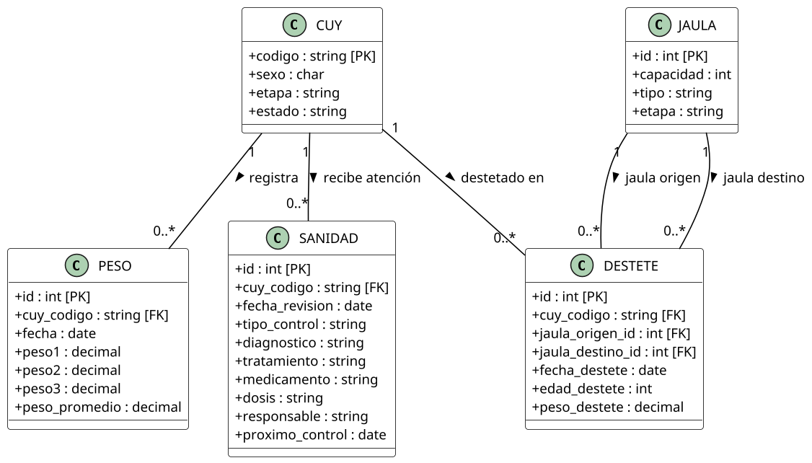
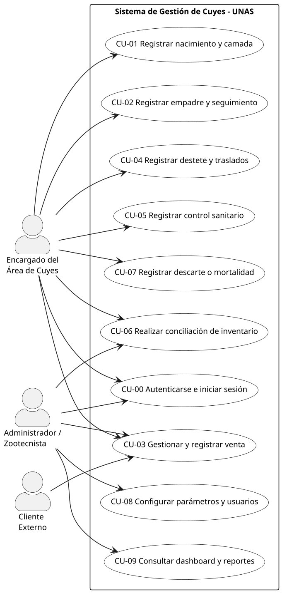
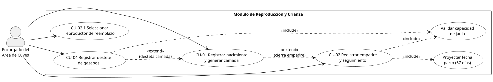
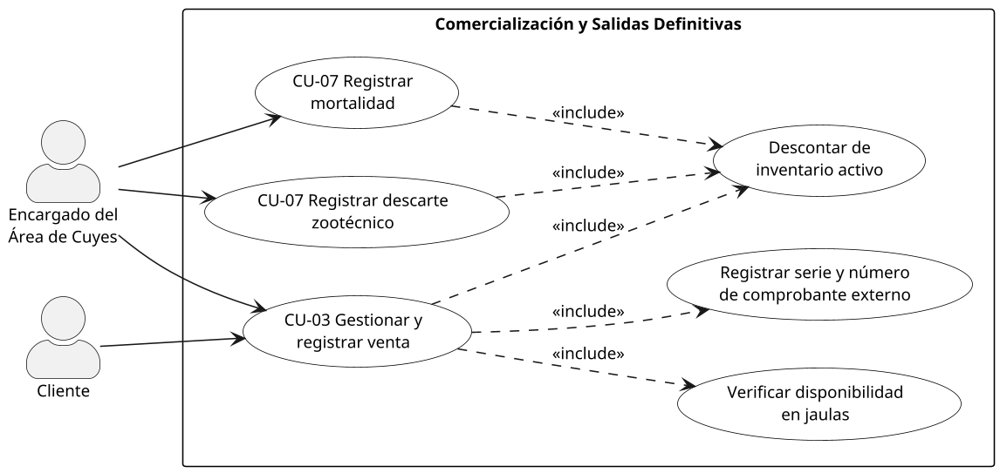

# Modelo del dominio

## Modelo conceptual del dominio

El modelo conceptual describe **qué conceptos existen en la crianza de cuyes y cómo se relacionan**, sin detalles de implementación; su traducción a tablas se presenta en el Diseño de datos (sección 4). Se organiza en cuatro vistas.

```plantuml {caption="Modelo conceptual: alojamiento, razas e identificación"}
@startuml
skinparam dpi 150
skinparam shadowing false
skinparam packageStyle rectangle
skinparam defaultFontSize 12
skinparam classAttributeIconSize 0
skinparam class {
  BackgroundColor White
  ArrowColor Black
  BorderColor Black
}

class RAZA {
  +codigo : string [PK]
  +nombre : string
  +descripcion : string
}

class JAULA {
  +id : int [PK]
  +capacidad : int
  +tipo : string
  +cantidad_actual : int
  +num_hembras : int
  +num_machos : int
  +etapa : string
  +estado : string
  +raza_predominante : string
}

class CUY {
  +codigo : string [PK]
  +madre_codigo : string [FK]
  +padre_codigo : string [FK]
  +raza_id : string [FK]
  +jaula_id : int [FK]
  +camada_id : int [FK]
  +sexo : char
  +fecha_nacimiento : date
  +etapa : string
  +condicion : string
  +estado : string
}

class MOVIMIENTO_JAULA {
  +id : int [PK]
  +cuy_codigo : string [FK]
  +jaula_origen_id : int [FK]
  +jaula_destino_id : int [FK]
  +fecha : date
  +motivo : string
}

RAZA "1" -- "0..*" CUY : clasifica >
JAULA "1" -- "0..*" CUY : alberga >
CUY "1" -- "0..*" MOVIMIENTO_JAULA : registra >
JAULA "1" -- "0..*" MOVIMIENTO_JAULA : origen >
JAULA "1" -- "0..*" MOVIMIENTO_JAULA : destino >
CUY "0..1" -- "0..*" CUY : es madre de >
CUY "0..1" -- "0..*" CUY : es padre de >
@enduml
```

```plantuml {caption="Modelo conceptual: reproducción, camadas y genealogía"}
@startuml
skinparam dpi 150
skinparam shadowing false
skinparam packageStyle rectangle
skinparam defaultFontSize 12
skinparam classAttributeIconSize 0
skinparam class {
  BackgroundColor White
  ArrowColor Black
  BorderColor Black
}

class EMPADRE {
  +id : int [PK]
  +jaula_id : int [FK]
  +raza_id : string [FK]
  +macho_codigo : string [FK]
  +fecha_inicio : date
  +fecha_fin_estimada : date
  +estado : string
  +observaciones : string
}

class DETALLE_EMPADRE {
  +id : int [PK]
  +empadre_id : int [FK]
  +cuy_codigo : string [FK]
}

class PARTO {
  +id : int [PK]
  +empadre_id : int [FK]
  +madre_codigo : string [FK]
  +fecha_parto : date
  +num_crias : int
  +nacidos_vivos : int
  +nacidos_muertos : int
}

class NACIMIENTO {
  +id : int [PK]
  +jaula_id : int [FK]
  +raza_id : string [FK]
  +fecha : date
  +num_crias : int
  +num_machos : int
  +num_hembras : int
  +nacidos_vivos : int
  +nacidos_muertos : int
  +observaciones : string
}

class CAMADA {
  +id : int [PK]
  +nacimiento_id : int [FK]
}

class SELECCION_REPRODUCTOR {
  +id : int [PK]
  +cuy_codigo : string [FK]
  +fecha : date
  +tipo : string
  +observaciones : string
}

class CUY {
  +codigo : string [PK]
  +sexo : char
  +etapa : string
  +estado : string
}

EMPADRE "1" -- "1..*" DETALLE_EMPADRE : agrupa >
CUY "1" -- "0..*" DETALLE_EMPADRE : hembra participante >
CUY "1" -- "0..*" EMPADRE : macho reproductor >
EMPADRE "1" -- "0..*" PARTO : origina >
CUY "1" -- "0..*" PARTO : hembra paridora >
NACIMIENTO "1" -- "1" CAMADA : genera >
CAMADA "1" -- "1..*" CUY : compone >
CUY "1" -- "0..*" SELECCION_REPRODUCTOR : evaluado en >
@enduml
```



```plantuml {caption="Modelo conceptual: salidas del criadero e inventario"}
@startuml
skinparam dpi 150
skinparam shadowing false
skinparam packageStyle rectangle
skinparam defaultFontSize 12
skinparam classAttributeIconSize 0
skinparam class {
  BackgroundColor White
  ArrowColor Black
  BorderColor Black
}

class CUY {
  +codigo : string [PK]
  +sexo : char
  +etapa : string
  +estado : string
}

class RAZA {
  +codigo : string [PK]
  +nombre : string
}

class JAULA {
  +id : int [PK]
  +capacidad : int
  +cantidad_actual : int
}

class VENTA {
  +id : int [PK]
  +numero : string
  +fecha : date
  +cuy_codigo : string [FK]
  +raza_id : string [FK]
  +sexo : char
  +peso : decimal
  +precio : decimal
  +comprobante_serie : string
  +comprobante_numero : string
  +cliente : string
  +observaciones : string
}

class DESCARTE {
  +id : int [PK]
  +cuy_codigo : string [FK]
  +fecha : date
  +edad : int
  +tiempo_reproductor : int
  +num_partos : int
  +total_crias : int
  +promedio_crias : decimal
  +motivo : string
  +destino : string
}

class MORTALIDAD {
  +id : int [PK]
  +cuy_codigo : string [FK]
  +jaula_id : int [FK]
  +raza_id : string [FK]
  +fecha_muerte : date
  +edad : int
  +etapa : string
  +sexo : char
  +causa : string
  +observaciones : string
}

class INVENTARIO {
  +id : int [PK]
  +fecha : date
  +jaula_id : int [FK]
  +cantidad_machos : int
  +cantidad_hembras : int
  +raza_id : string [FK]
  +etapa : string
  +peso_muestra1 : decimal
  +peso_muestra2 : decimal
  +peso_muestra3 : decimal
  +peso_promedio : decimal
  +cantidad_sistema : int
  +diferencia : int
  +observaciones : string
}

CUY "1" -- "0..1" VENTA : dado de baja por >
RAZA "1" -- "0..*" VENTA : clasifica venta >
CUY "1" -- "0..1" DESCARTE : retirado por >
CUY "1" -- "0..1" MORTALIDAD : registrado en >
JAULA "1" -- "0..*" MORTALIDAD : ocurre en >
RAZA "1" -- "0..*" MORTALIDAD : raza del animal >
JAULA "1" -- "0..*" INVENTARIO : auditada en >
RAZA "1" -- "0..*" INVENTARIO : raza evaluada >
@enduml
```

Los atributos de cada concepto figuran en los diagramas; la tabla resume su significado en el negocio.

| Concepto | Significado en el negocio |
|----------------|----------------------------------------------------------|
| CUY | Animal individual: identidad, genealogía (madre y padre), ubicación y estado zootécnico. |
| RAZA | Línea genética del catálogo (Perú, Andina, Inti, Tipo 2–4, línea criolla negra). |
| JAULA | Poza de alojamiento con capacidad, etapa y conteo por sexo; base del control de sobrecupo. |
| MOVIMIENTO_JAULA | Traslado de un cuy entre jaulas con fecha y motivo. |
| EMPADRE / DETALLE_EMPADRE | Lote de apareamiento: un macho y sus hembras participantes. |
| PARTO | Fin de la gestación de una hembra, asociado al empadre que lo originó. |
| NACIMIENTO / CAMADA | Crías de un parto, con vivos, muertos y desglose por sexo. |
| SELECCION_REPRODUCTOR | Elección de un animal como reproductor de reemplazo. |
| DESTETE | Separación de la madre con edad, peso y jaula de recría. |
| PESO | Control biométrico individual o muestral. |
| SANIDAD | Atención preventiva o curativa con diagnóstico, medicamento, dosis y responsable. |
| VENTA | Salida comercial respaldada por la serie y número del comprobante de la caja UNAS. |
| DESCARTE | Retiro planificado de reproductores al fin de su vida útil. |
| MORTALIDAD | Baja por muerte con causa y circunstancias. |
| INVENTARIO | Conteo físico por jaula contrastado con las existencias del sistema. |

## Casos de uso principales

| Código | Caso de uso | Actor principal | Objetivo |
|--------|----------------------------------|---------------------|----------------------------------------|
| CU-01 | Registrar nacimiento y generar camada | Encargado | Registrar el parto y dar de alta a cada cría vinculada a sus progenitores. |
| CU-02 | Registrar empadre y seguimiento | Encargado | Formar el lote macho–hembras y proyectar el parto a 67 días. |
| CU-03 | Gestionar y registrar venta | Encargado / Cliente | Vender con stock verificado, comprobante externo y baja del inventario. |
| CU-04 | Registrar destete y traslado | Encargado | Pasar las crías a recría validando la capacidad de la jaula. |
| CU-05 | Registrar atención sanitaria | Encargado / Zootecnista | Registrar tratamientos preventivos o curativos. |
| CU-06 | Conciliar inventario físico | Encargado / Auditor | Contrastar el conteo en jaulas con las existencias del sistema. |
| CU-07 | Registrar descarte o mortalidad | Encargado | Dar de baja definitiva a un animal de la población activa. |







```plantuml {caption="Casos de uso de sanidad, jaulas, inventario y reportes"}
@startuml
left to right direction
skinparam dpi 150
skinparam shadowing false
skinparam packageStyle rectangle
skinparam defaultFontSize 12
skinparam actorStyle awesome
skinparam rectangle {
  BackgroundColor White
  BorderColor Black
}
skinparam usecase {
  BackgroundColor White
  BorderColor Black
}

actor "Encargado del\nÁrea de Cuyes" as EN
actor "Administrador /\nZootecnista" as AD

rectangle "Sanidad, ubicación e información" {
  usecase "CU-05 Registrar atención\nsanitaria" as UC05
  usecase "Programar alerta\nsanitaria" as UC_ALERT
  usecase "Registrar pesaje\nmuestral o individual" as UC_PESO
  usecase "Reubicar animales\nentre jaulas" as UC_MOV
  usecase "Validar sobrecupo\nen jaula destino" as UC_SOBRE
  usecase "CU-06 Conciliar\ninventario físico" as UC06
  usecase "Calcular diferencia\n(físico - sistema)" as UC_DISC
  usecase "CU-09 Consultar\nindicadores" as UC09
  usecase "Exportar reportes\nen Excel" as UC_EXP
}

EN --> UC05
EN --> UC_PESO
EN --> UC_MOV
EN --> UC06
AD --> UC05
AD --> UC06
AD --> UC09

UC05 ..> UC_ALERT : <<extend>>
UC_MOV ..> UC_SOBRE : <<include>>
UC06 ..> UC_DISC : <<include>>
UC09 ..> UC_EXP : <<extend>>
@enduml
```

Las especificaciones siguen un mismo formato: actor, condiciones previas y posteriores, flujo principal y flujos alternativos. Todas las operaciones exigen sesión iniciada y quedan registradas en la bitácora de auditoría, por lo que esas condiciones no se repiten en cada caso.

### CU-01. Registrar nacimiento y generar camada

| Elemento | Detalle |
|--------------|--------------------------------------------------------|
| Actor | Encargado del área de cuyes |
| Precondiciones | Jaula de maternidad activa; madre registrada (opcionalmente vinculada a un empadre). |
| Postcondiciones | Parto y camada registrados; cada cría dada de alta como `CUY` activo con su filiación; población de la jaula actualizada. |

**Flujo principal**

1. El encargado abre *Registrar parto* y elige la jaula y la madre; el sistema carga raza y macho del empadre.
2. Ingresa fecha, crías vivas por sexo, muertas y pesos al nacer; el sistema verifica que vivos + muertos = total.
3. Confirma los códigos de las crías; el sistema valida que no existan.
4. Guarda; el sistema registra parto, camada y crías en una sola transacción y muestra la confirmación.

**Flujos alternativos**

- **FA-1.1** Balance de crías inconsistente: se resalta el error y no se permite guardar.
- **FA-1.2** Fecha futura o anterior al empadre: se rechaza (400).
- **FA-1.3** Código de cría duplicado: se rechaza (409) y se propone el siguiente correlativo.
- **FA-1.4** Jaula sin espacio: se advierte el sobrecupo y se pide confirmación.

### CU-02. Registrar empadre y seguimiento reproductivo

| Elemento | Detalle |
|--------------|--------------------------------------------------------|
| Actor | Encargado del área de cuyes |
| Precondiciones | Macho reproductor activo; hembras activas sin empadre abierto; jaula con capacidad. |
| Postcondiciones | Empadre en curso con fecha probable de parto; hembras vinculadas; alerta de parto programada. |

**Flujo principal**

1. Abre *Nuevo empadre* y elige jaula y raza; el sistema muestra la capacidad.
2. Elige el macho; el sistema verifica que no esté en otro empadre activo.
3. Elige las hembras; el sistema verifica que no estén gestando y la relación hembras/macho.
4. Indica la fecha de inicio; el sistema calcula el parto probable (+67 días).
5. Guarda; el sistema registra el empadre, las hembras y la ubicación de los animales.

**Flujos alternativos**

- **FA-2.1** Macho en otro empadre activo: se rechaza la selección.
- **FA-2.2** Hembra en otro empadre activo: se excluye y se notifica.
- **FA-2.3** Hembras exceden la capacidad de la jaula: se bloquea hasta ajustar.

### CU-03. Gestionar y registrar venta de cuyes

| Elemento | Detalle |
|--------------|--------------------------------------------------------|
| Actores | Encargado del área de cuyes (principal); Cliente y Caja UNAS (externos) |
| Precondiciones | Solicitud del cliente; existen animales activos aptos para la venta. |
| Postcondiciones | Venta registrada con serie y número de comprobante; animales en estado `baja_venta` y fuera de su jaula; inventario actualizado. |

**Flujo principal**

1. El cliente solicita cuyes (cantidad, sexo, destino); el encargado consulta la disponibilidad por jaula, raza, sexo y peso.
2. Acuerdan ejemplares y precio; el cliente paga en la caja de la UNAS y vuelve con el comprobante.
3. El encargado verifica el comprobante (importe, sello, fecha).
4. Registra la venta con serie, número, cliente, peso y precio; el sistema valida campos, unicidad del comprobante y disponibilidad.
5. Confirma; el sistema registra la venta y da de baja a los animales en la misma transacción. Se entregan los cuyes.

**Flujos alternativos**

- **FA-3.1** Sin stock: se informa al cliente y no se registra venta.
- **FA-3.2** Comprobante con enmiendas o importe menor: se rechaza hasta su rectificación en caja.
- **FA-3.3** Comprobante ya usado: el sistema impide guardar (409).
- **FA-3.4** Animal dado de baja o trasladado durante el pago: se avisa y se elige otro equivalente.

### CU-04. Registrar destete y movimiento entre jaulas

| Elemento | Detalle |
|--------------|--------------------------------------------------------|
| Actor | Encargado del área de cuyes |
| Precondiciones | Camada con crías en lactancia; jaula de recría activa. |
| Postcondiciones | Destete registrado con edad y peso; crías trasladadas (movimiento registrado) y conteos de ambas jaulas actualizados. |

**Flujo principal**

1. Elige la camada; el sistema muestra las crías con su fecha de nacimiento.
2. Indica la jaula de recría (por sexo); el sistema muestra ocupación y capacidad.
3. Ingresa fecha y pesos; el sistema calcula la edad y valida fecha y rangos de peso.
4. Procesa; el sistema registra destete, movimientos y nueva etapa en una transacción.

**Flujos alternativos**

- **FA-4.1** La jaula superaría su capacidad: se pide elegir otra o confirmar (409 `requiere_confirmacion`).
- **FA-4.2** Peso fuera de rango (menos de 150 g o más de 600 g): se pide confirmar el valor.

### CU-05. Registrar atención y tratamiento sanitario

| Elemento | Detalle |
|--------------|--------------------------------------------------------|
| Actor | Encargado del área de cuyes / Zootecnista |
| Precondiciones | Animales activos (o jaula/área para tratamientos colectivos). |
| Postcondiciones | Tratamiento registrado en el historial; alerta programada si requiere seguimiento. |

**Flujo principal**

1. Elige el animal, la jaula o el área; el sistema muestra el historial previo.
2. Indica tipo (preventivo o curativo), diagnóstico, producto, dosis, vía, inicio y duración.
3. Guarda; el sistema calcula la fecha de término y registra el tratamiento en curso.

**Flujos alternativos**

- **FA-5.1** Animal dado de baja: no se permite el registro.
- **FA-5.2** Fechas inconsistentes: se impide guardar hasta corregirlas.

### CU-06. Realizar toma y conciliación de inventario físico

| Elemento | Detalle |
|--------------|--------------------------------------------------------|
| Actor | Encargado del área de cuyes / Auditor |
| Precondiciones | Jaulas registradas. |
| Postcondiciones | Conteo registrado con peso promedio muestral y diferencia (físico − sistema). |

**Flujo principal**

1. Elige la jaula e ingresa machos y hembras contados; el sistema obtiene la cantidad registrada.
2. Ingresa tres pesos de muestra; el sistema calcula el promedio y la diferencia.
3. Añade observaciones si hay diferencia y guarda; la ingeniera revisa el consolidado mensual.

**Flujos alternativos**

- **FA-6.1** Diferencia negativa: las observaciones son obligatorias (fuga, muerte no reportada, error de conteo).
- **FA-6.2** Peso menor o igual a cero: se rechaza.

### CU-07. Registrar descarte zootécnico o mortalidad

| Elemento | Detalle |
|--------------|--------------------------------------------------------|
| Actor | Encargado del área de cuyes |
| Precondiciones | Animal activo. |
| Postcondiciones | Baja registrada; animal en estado `baja_muerte` o `descarte` y fuera del inventario activo. |

**Flujo principal**

1. Elige el tipo de baja y busca el animal por código; el sistema carga su jaula, raza, etapa e historial reproductivo.
2. Para mortalidad ingresa fecha y causa; para descarte, motivo y destino.
3. Confirma; el sistema registra la baja y actualiza el estado del animal en una transacción.

**Flujos alternativos**

- **FA-7.1** Animal ya dado de baja: se bloquea la acción.
- **FA-7.2** Hembra en un empadre activo: se pide retirarla del lote antes del descarte.

## Glosario de términos del negocio

| Término | Definición |
|----------------|----------------------------------------------------------|
| Cuy (*Cavia porcellus*) | Roedor doméstico andino criado para investigación, mejora genética y carne; entidad central del sistema. |
| Código único | Identificador normalizado de cada animal dentro de su granja; se compara sin espacios ni diferencias de mayúsculas. |
| Jerarquía | Organización especie → granja → área → jaula → animal. |
| Granja | Unidad de crianza de una sola especie; cada usuario opera solo en las granjas asignadas. |
| Área | Agrupación de jaulas con un propósito (maternidad, recría, engorde, empadre). |
| Jaula / poza | Alojamiento con capacidad máxima; el exceso es **sobrecupo** y exige confirmación. |
| Raza | Línea genética: Perú (crecimiento), Andina (prolificidad), Inti, Tipo 2–4 y línea criolla negra. |
| Categoría / etapa | Fase productiva del animal: gazapo, recría, engorde, reproductor, reemplazo o venta. |
| Gazapo | Cría desde el nacimiento hasta el destete. |
| Destete | Separación de la madre a los 15 días con registro de peso y jaula de recría. |
| Recría / engorde | Desarrollo tras el destete y alimentación final hasta el peso comercial. |
| Empadre | Apareamiento de un macho con 5 a 8 hembras aptas en una jaula. |
| Gestación | Desarrollo embrionario; dura ~67 días. |
| Parto / camada | Alumbramiento de una hembra y conjunto de crías nacidas en él. |
| Reproductor / reemplazo | Animal del plantel de cría / animal seleccionado para sustituir a un reproductor descartado. |
| Pesaje | Peso en gramos, individual o por lote, comparado con el rango de su categoría. |
| Sanidad | Tratamiento preventivo (desparasitación, vitaminas) o curativo, con producto, dosis y duración. |
| Descarte | Salida planificada de un reproductor improductivo (6 partos, baja fertilidad, lesiones). |
| Mortalidad | Baja por muerte con fecha, jaula y causa. |
| Venta | Salida comercial respaldada por el comprobante de la caja UNAS (serie y número). |
| Inventario | Población activa calculada a partir de los eventos registrados. |
| Trazabilidad | Capacidad de reconstruir la vida completa de un cuy: genealogía, jaulas, pesajes, sanidad y salida. |
| Alerta | Aviso de un plazo próximo o vencido (parto, destete, pesaje, tratamiento). |

| Término técnico | Definición |
|----------------|----------------------------------------------------------|
| Monolito modular | Una sola aplicación desplegable dividida en módulos con fronteras explícitas. |
| Clean Architecture | Capas concéntricas donde el dominio no depende de frameworks ni de la base de datos. |
| Puerto / adaptador | Contrato abstracto del dominio / implementación concreta (repositorio, controlador REST). |
| Guard | Componente de NestJS que autoriza una petición (token, rol, granja, especie). |
| JWT | Token firmado que identifica al usuario en cada petición (`Authorization: Bearer`). |
| Borrado lógico | Marcar un registro como inactivo o anulado en lugar de eliminarlo. |
| Bitácora de auditoría | Registro de quién hizo qué y cuándo, con el valor anterior y el nuevo. |
| BPMN | Notación estándar para modelar procesos de negocio. |
| API REST | Interfaz HTTP con JSON bajo `/api/v1`; ORM: mapeo objeto-relacional (Prisma). |
