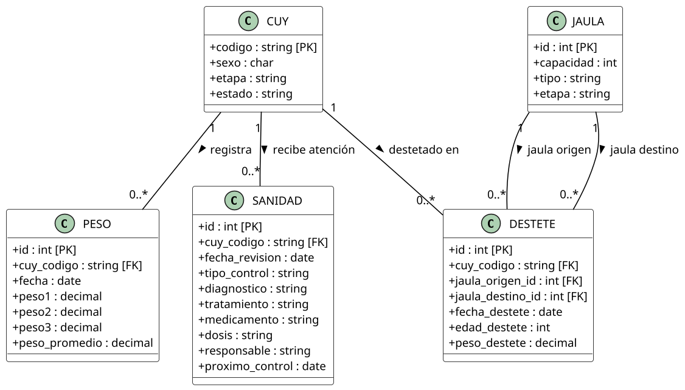
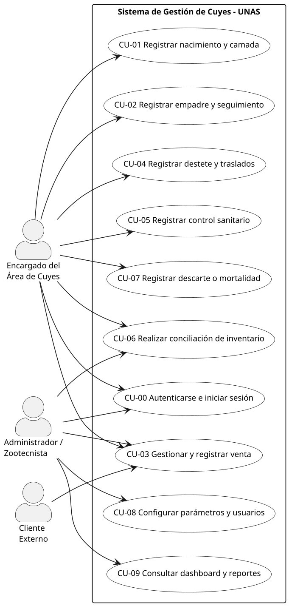
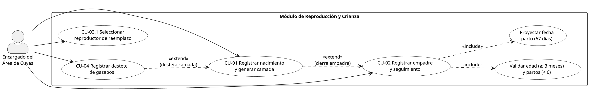
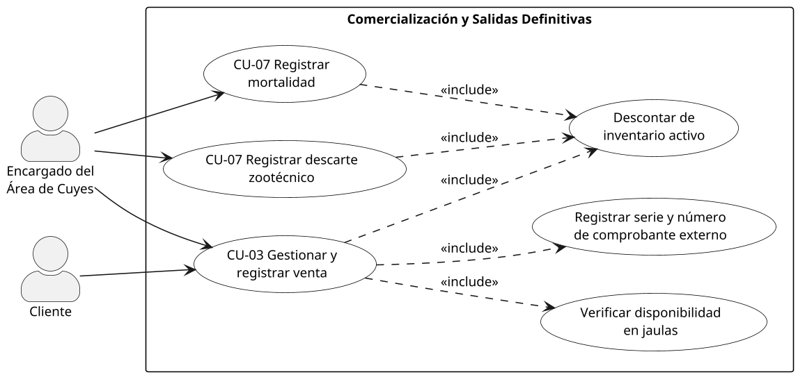

# Modelo del dominio

## Modelo conceptual del dominio

El modelo conceptual describe **qué conceptos existen en la crianza de cuyes y cómo se relacionan**, sin detalles de implementación; su traducción a tablas se presenta en el Diseño de datos (sección 4). Se organiza en cuatro vistas.

```plantuml {caption="Modelo conceptual: alojamiento, razas e identificación"}
@startuml
skinparam dpi 150
skinparam shadowing false
skinparam packageStyle rectangle
skinparam defaultFontSize 12
skinparam classAttributeIconSize 0
skinparam class {
  BackgroundColor White
  ArrowColor Black
  BorderColor Black
}

class RAZA {
  +codigo : string [PK]
  +nombre : string
  +descripcion : string
}

class JAULA {
  +id : int [PK]
  +capacidad : int
  +tipo : string
  +cantidad_actual : int
  +num_hembras : int
  +num_machos : int
  +etapa : string
  +estado : string
  +raza_predominante : string
}

class CUY {
  +codigo : string [PK]
  +madre_codigo : string [FK]
  +padre_codigo : string [FK]
  +raza_id : string [FK]
  +jaula_id : int [FK]
  +camada_id : int [FK]
  +sexo : char
  +fecha_nacimiento : date
  +etapa : string
  +condicion : string
  +estado : string
}

class MOVIMIENTO_JAULA {
  +id : int [PK]
  +cuy_codigo : string [FK]
  +jaula_origen_id : int [FK]
  +jaula_destino_id : int [FK]
  +fecha : date
  +motivo : string
}

RAZA "1" -- "0..*" CUY : clasifica >
JAULA "1" -- "0..*" CUY : alberga >
CUY "1" -- "0..*" MOVIMIENTO_JAULA : registra >
JAULA "1" -- "0..*" MOVIMIENTO_JAULA : origen >
JAULA "1" -- "0..*" MOVIMIENTO_JAULA : destino >
CUY "0..1" -- "0..*" CUY : es madre de >
CUY "0..1" -- "0..*" CUY : es padre de >
@enduml
```

```plantuml {caption="Modelo conceptual: reproducción, camadas y genealogía"}
@startuml
skinparam dpi 150
skinparam shadowing false
skinparam packageStyle rectangle
skinparam defaultFontSize 12
skinparam classAttributeIconSize 0
skinparam class {
  BackgroundColor White
  ArrowColor Black
  BorderColor Black
}

class EMPADRE {
  +id : int [PK]
  +jaula_id : int [FK]
  +raza_id : string [FK]
  +macho_codigo : string [FK]
  +fecha_inicio : date
  +fecha_fin_estimada : date
  +estado : string
  +observaciones : string
}

class DETALLE_EMPADRE {
  +id : int [PK]
  +empadre_id : int [FK]
  +cuy_codigo : string [FK]
}

class PARTO {
  +id : int [PK]
  +empadre_id : int [FK]
  +madre_codigo : string [FK]
  +fecha_parto : date
  +num_crias : int
  +nacidos_vivos : int
  +nacidos_muertos : int
}

class NACIMIENTO {
  +id : int [PK]
  +jaula_id : int [FK]
  +raza_id : string [FK]
  +fecha : date
  +num_crias : int
  +num_machos : int
  +num_hembras : int
  +nacidos_vivos : int
  +nacidos_muertos : int
  +observaciones : string
}

class CAMADA {
  +id : int [PK]
  +nacimiento_id : int [FK]
}

class SELECCION_REPRODUCTOR {
  +id : int [PK]
  +cuy_codigo : string [FK]
  +fecha : date
  +tipo : string
  +observaciones : string
}

class CUY {
  +codigo : string [PK]
  +sexo : char
  +etapa : string
  +estado : string
}

EMPADRE "1" -- "1..*" DETALLE_EMPADRE : agrupa >
CUY "1" -- "0..*" DETALLE_EMPADRE : hembra participante >
CUY "1" -- "0..*" EMPADRE : macho reproductor >
EMPADRE "1" -- "0..*" PARTO : origina >
CUY "1" -- "0..*" PARTO : hembra paridora >
NACIMIENTO "1" -- "1" CAMADA : genera >
CAMADA "1" -- "1..*" CUY : compone >
CUY "1" -- "0..*" SELECCION_REPRODUCTOR : evaluado en >
@enduml
```



```plantuml {caption="Modelo conceptual: salidas del criadero e inventario"}
@startuml
skinparam dpi 150
skinparam shadowing false
skinparam packageStyle rectangle
skinparam defaultFontSize 12
skinparam classAttributeIconSize 0
skinparam class {
  BackgroundColor White
  ArrowColor Black
  BorderColor Black
}

class CUY {
  +codigo : string [PK]
  +sexo : char
  +etapa : string
  +estado : string
}

class RAZA {
  +codigo : string [PK]
  +nombre : string
}

class JAULA {
  +id : int [PK]
  +capacidad : int
  +cantidad_actual : int
}

class VENTA {
  +id : int [PK]
  +numero : string
  +fecha : date
  +cuy_codigo : string [FK]
  +raza_id : string [FK]
  +sexo : char
  +peso : decimal
  +precio : decimal
  +comprobante_serie : string
  +comprobante_numero : string
  +cliente : string
  +observaciones : string
}

class DESCARTE {
  +id : int [PK]
  +cuy_codigo : string [FK]
  +fecha : date
  +edad : int
  +tiempo_reproductor : int
  +num_partos : int
  +total_crias : int
  +promedio_crias : decimal
  +motivo : string
  +destino : string
}

class MORTALIDAD {
  +id : int [PK]
  +cuy_codigo : string [FK]
  +jaula_id : int [FK]
  +raza_id : string [FK]
  +fecha_muerte : date
  +edad : int
  +etapa : string
  +sexo : char
  +causa : string
  +observaciones : string
}

class INVENTARIO {
  +id : int [PK]
  +fecha : date
  +jaula_id : int [FK]
  +cantidad_machos : int
  +cantidad_hembras : int
  +raza_id : string [FK]
  +etapa : string
  +peso_muestra1 : decimal
  +peso_muestra2 : decimal
  +peso_muestra3 : decimal
  +peso_promedio : decimal
  +cantidad_sistema : int
  +diferencia : int
  +observaciones : string
}

CUY "1" -- "0..1" VENTA : dado de baja por >
RAZA "1" -- "0..*" VENTA : clasifica venta >
CUY "1" -- "0..1" DESCARTE : retirado por >
CUY "1" -- "0..1" MORTALIDAD : registrado en >
JAULA "1" -- "0..*" MORTALIDAD : ocurre en >
RAZA "1" -- "0..*" MORTALIDAD : raza del animal >
JAULA "1" -- "0..*" INVENTARIO : auditada en >
RAZA "1" -- "0..*" INVENTARIO : raza evaluada >
@enduml
```

Los atributos de cada concepto figuran en los diagramas; la tabla resume su significado en el negocio.

| Concepto | Significado en el negocio |
|----------------|----------------------------------------------------------|
| CUY | Animal individual: identidad, genealogía (madre y padre), ubicación y estado zootécnico. |
| RAZA | Línea genética del catálogo (Perú, Andina, Inti, Tipo 2–4, línea criolla negra). |
| JAULA | Poza de alojamiento con capacidad, etapa y conteo por sexo; base del control de sobrecupo. |
| MOVIMIENTO_JAULA | Traslado de un cuy entre jaulas con fecha y motivo. |
| EMPADRE / DETALLE_EMPADRE | Lote de apareamiento: un macho y sus hembras participantes. |
| PARTO | Fin de la gestación de una hembra, asociado al empadre que lo originó. |
| NACIMIENTO / CAMADA | Crías de un parto, con vivos, muertos y desglose por sexo. |
| SELECCION_REPRODUCTOR | Elección de un animal como reproductor de reemplazo. |
| DESTETE | Separación de la madre con edad, peso y jaula de recría. |
| PESO | Control biométrico individual o muestral. |
| SANIDAD | Atención preventiva o curativa con diagnóstico, medicamento, dosis y responsable. |
| VENTA | Salida comercial respaldada por la serie y número del comprobante de la caja UNAS. |
| DESCARTE | Retiro planificado de reproductores al fin de su vida útil. |
| MORTALIDAD | Baja por muerte con causa y circunstancias. |
| INVENTARIO | Conteo físico por jaula contrastado con las existencias del sistema. |

## Casos de uso principales

| Código | Caso de uso | Actor principal | Objetivo |
|--------|----------------------------------|---------------------|----------------------------------------|
| CU-01 | Registrar nacimiento y generar camada | Encargado | Registrar el parto y dar de alta a cada cría vinculada a sus progenitores. |
| CU-02 | Registrar empadre y seguimiento | Encargado | Formar el lote macho–hembras y proyectar el parto a 67 días. |
| CU-03 | Gestionar y registrar venta | Encargado / Cliente | Vender con stock verificado, comprobante externo y baja del inventario. |
| CU-04 | Registrar destete | Encargado | Pasar las crías a recría y a la jaula de su sexo. |
| CU-05 | Registrar atención sanitaria | Encargado / Zootecnista | Registrar tratamientos preventivos o curativos. |
| CU-06 | Conciliar inventario físico | Encargado / Supervisor | Contrastar el conteo en jaulas con las existencias del sistema. |
| CU-07 | Registrar descarte o mortalidad | Encargado | Dar de baja definitiva a un animal de la población activa. |







```plantuml {caption="Casos de uso de sanidad, jaulas, inventario y reportes"}
@startuml
left to right direction
skinparam dpi 150
skinparam shadowing false
skinparam packageStyle rectangle
skinparam defaultFontSize 12
skinparam actorStyle awesome
skinparam rectangle {
  BackgroundColor White
  BorderColor Black
}
skinparam usecase {
  BackgroundColor White
  BorderColor Black
}

actor "Encargado del\nÁrea de Cuyes" as EN
actor "Administrador /\nZootecnista" as AD

rectangle "Sanidad, ubicación e información" {
  usecase "CU-05 Registrar atención\nsanitaria" as UC05
  usecase "Registrar pesaje\nmuestral o individual" as UC_PESO
  usecase "Reubicar animales\nentre jaulas" as UC_MOV
  usecase "Validar sobrecupo\nen jaula destino" as UC_SOBRE
  usecase "CU-06 Conciliar\ninventario físico" as UC06
  usecase "Calcular diferencia\n(físico - sistema)" as UC_DISC
  usecase "CU-09 Consultar\nindicadores" as UC09
  usecase "Exportar reportes\nen Excel" as UC_EXP
}

EN --> UC05
EN --> UC_PESO
EN --> UC_MOV
EN --> UC06
AD --> UC05
AD --> UC06
AD --> UC09

UC_MOV ..> UC_SOBRE : <<include>>
UC06 ..> UC_DISC : <<include>>
UC09 ..> UC_EXP : <<extend>>
@enduml
```

Las especificaciones describen el comportamiento implementado y siguen un mismo formato: actor, condiciones previas y posteriores, flujo principal y flujos alternativos. Todas las operaciones exigen sesión iniciada, se limitan a la granja activa, se ejecutan en una transacción y quedan registradas en la bitácora de auditoría; por eso esas condiciones no se repiten en cada caso.

### CU-01. Registrar nacimiento y generar camada

| Elemento | Detalle |
|--------------|--------------------------------------------------------|
| Actor | Encargado del área de cuyes (también admin y auxiliar) |
| Precondiciones | La madre es una hembra activa de la granja; opcionalmente pertenece a un empadre. |
| Postcondiciones | Parto registrado; si viene de un empadre, la hembra queda con resultado *preñez*; la madre pasa a la categoría reproductora; cada cría viva se da de alta como animal activo, categoría gazapo, con la raza y la jaula de la madre y vinculada al parto (genealogía); los pesos al nacer quedan como primer pesaje. |

**Flujo principal**

1. El encargado abre *Registrar parto* y elige la madre y, si corresponde, el empadre.
2. Ingresa la fecha, las crías vivas por sexo, las muertas y hasta tres pesos por sexo.
3. Guarda; el sistema genera el código de cada cría (código de la madre + número de parto + sexo y número, por ejemplo `U101-P35-M1`), registra todo en una sola transacción y muestra la camada con su peso promedio.

**Flujos alternativos**

- **FA-1.1** Fecha inválida o futura: se rechaza indicando el campo (400).
- **FA-1.2** No se indicó ninguna cría viva ni muerta: se rechaza.
- **FA-1.3** La madre no existe, no es hembra o no está activa: se rechaza.

### CU-02. Registrar empadre y seguimiento reproductivo

| Elemento | Detalle |
|--------------|--------------------------------------------------------|
| Actor | Encargado del área de cuyes (también admin y auxiliar) |
| Precondiciones | Macho y hembras activos de la granja. |
| Postcondiciones | Empadre registrado con sus hembras en estado *abierto*. El panel muestra la alerta de parto próximo a los 67 días, la de preñez sin confirmar a los 30 días y la de hembra disponible para un nuevo empadre (plazos configurables). |

**Flujo principal**

1. Abre *Nuevo empadre* y elige la jaula, el macho reproductor y las hembras.
2. Indica la fecha de inicio y, al cierre, cuántas hembras quedaron preñadas.
3. Guarda; el sistema valida las reglas zootécnicas de cada hembra y registra el empadre.
4. Durante la gestación registra el resultado de cada hembra (preñez, vacía, aborto o muerte) y cierra el empadre indicando la jaula de retorno del macho.

**Flujos alternativos**

- **FA-2.1** Fecha inválida o futura: se rechaza (400).
- **FA-2.2** Hembra con menos de 3 meses de edad: se rechaza indicando la hembra.
- **FA-2.3** Hembra con 6 partos: se rechaza y se indica que debe descartarse.
- **FA-2.4** Fecha anterior al último parto de la hembra: se rechaza.
- **FA-2.5** Macho o hembra inexistente, de otro sexo o inactivo: se rechaza.

### CU-03. Gestionar y registrar venta de cuyes

| Elemento | Detalle |
|--------------|--------------------------------------------------------|
| Actores | Encargado del área de cuyes (principal); Cliente y Caja UNAS (externos) |
| Precondiciones | Solicitud del cliente; existen animales activos (o marcados como descarte) para vender. |
| Postcondiciones | Venta registrada con tipo, serie y número de comprobante; los animales vendidos quedan en estado `baja_venta` con fecha y motivo; el inventario los descuenta. |

**Flujo principal**

1. El cliente solicita cuyes; el encargado consulta la disponibilidad por categoría o elige el animal.
2. Acuerdan cantidad y precio; el cliente paga en la caja de la UNAS y vuelve con el comprobante.
3. El encargado verifica el comprobante (importe, sello y fecha).
4. Registra la venta individual o por lote —o la venta agrupada de descartes— con el tipo, la serie y el número del comprobante.
5. El sistema valida los datos, la población disponible, que el comprobante no se haya usado antes y que el animal siga activo; registra la venta y la baja en la misma transacción. Se entregan los cuyes.

**Flujos alternativos**

- **FA-3.1** La cantidad supera la población disponible de la categoría: se rechaza indicando cuántos hay.
- **FA-3.2** Falta el tipo, la serie o el número del comprobante: se rechaza indicando el dato (400).
- **FA-3.3** El comprobante ya se usó en otra venta no anulada (de cualquier granja): se rechaza (409) indicando la venta previa.
- **FA-3.4** El animal fue vendido, murió o se descartó mientras tanto: se rechaza (409) y se elige otro.
- **FA-3.5** En la venta de descartes, algún animal no está marcado como descarte: se rechaza toda la operación.
- **FA-3.6** Venta registrada por error: un admin, supervisor o encargado la anula con motivo; el comprobante vuelve a quedar disponible.

### CU-04. Registrar destete

| Elemento | Detalle |
|--------------|--------------------------------------------------------|
| Actor | Encargado del área de cuyes (también admin y auxiliar) |
| Precondiciones | Existe el parto con crías vivas. |
| Postcondiciones | Destete registrado; las crías pasan a la categoría recría y a la jaula de recría de su sexo; los pesos quedan como pesaje; las crías muertas antes del destete se dan de baja. |

**Flujo principal**

1. Elige el parto (camada) a destetar; el panel lo sugiere con la alerta de destete pendiente (14 días, configurable).
2. Indica la fecha, los destetados por sexo, los muertos, los pesos y la jaula de recría de machos y de hembras.
3. Guarda; el sistema actualiza la categoría y la jaula de cada cría en una transacción.

**Flujos alternativos**

- **FA-4.1** Fecha inválida, futura o anterior al parto: se rechaza (400).
- **FA-4.2** Destetados más muertos superan las crías nacidas vivas: se rechaza.
- **FA-4.3** El parto no existe en la granja: se rechaza (404).

### CU-05. Registrar atención y tratamiento sanitario

| Elemento | Detalle |
|--------------|--------------------------------------------------------|
| Actor | Encargado del área de cuyes, supervisor o zootecnista |
| Precondiciones | El destino del tratamiento existe: un animal, varios animales, una jaula o un área. |
| Postcondiciones | Tratamiento registrado *en curso* con su fecha de término (inicio + duración); al finalizar se cierra con una observación. Queda en el historial clínico de cada animal. |

**Flujo principal**

1. Elige el destino del tratamiento (animal, varios animales, jaula o área); el sistema obtiene los animales involucrados.
2. Indica tipo (preventivo o curativo), producto, dosis, vía, diagnóstico, responsable, fecha de inicio y duración en días.
3. Guarda; el sistema calcula la fecha de término y lo lista entre los tratamientos en curso.
4. Al terminar, registra el cierre con su motivo.

**Flujos alternativos**

- **FA-5.1** Falta producto, fecha de inicio o duración, o el tipo no es preventivo ni curativo: se rechaza.
- **FA-5.2** Fecha de inicio futura o duración menor o igual a cero: se rechaza (400).

### CU-06. Realizar toma y conciliación de inventario físico

| Elemento | Detalle |
|--------------|--------------------------------------------------------|
| Actor | Encargado del área de cuyes o supervisor |
| Precondiciones | La jaula está activa en la granja. |
| Postcondiciones | Conteo registrado junto con lo que el sistema tenía en ese momento; la diferencia y el peso promedio de la muestra se calculan al consultar. |

**Flujo principal**

1. Elige la fecha y la jaula; el sistema muestra los machos y las hembras registrados en ella.
2. Ingresa los machos y las hembras contados y, opcionalmente, tres pesos de muestra; el sistema muestra la diferencia en el momento.
3. Guarda; el conteo aparece en el historial con la diferencia resaltada.

**Flujos alternativos**

- **FA-6.1** Faltan animales (diferencia negativa): las observaciones son obligatorias.
- **FA-6.2** Conteo no entero o negativo, o peso menor o igual a cero: se rechaza indicando el campo.
- **FA-6.3** Fecha futura o jaula de otra granja: se rechaza (400 / 404).

### CU-07. Registrar descarte zootécnico o mortalidad

| Elemento | Detalle |
|--------------|--------------------------------------------------------|
| Actor | Encargado del área de cuyes (mortalidad); admin, supervisor o encargado (descarte desde el ranking) |
| Precondiciones | El animal sigue en la población (activo o marcado como descarte). |
| Postcondiciones | Mortalidad: registro con causa y animal en `baja_muerte`. Descarte: animal en estado `descarte`, listo para la venta de descartes (CU-03). |

**Flujo principal (mortalidad)**

1. Registra la fecha, la causa y el animal, o la cantidad y categoría si es un lote.
2. El sistema registra la mortalidad y da de baja al animal en la misma transacción.

**Flujo principal (descarte)**

1. Desde el ranking de reproductores, marca un animal como *descarte* (fin de vida productiva, por ejemplo al llegar a 6 partos).
2. El sistema cambia su estado, deja una nota y lo muestra en la lista de descartes para la venta.

**Flujos alternativos**

- **FA-7.1** El animal ya fue vendido o murió: se rechaza (409) para evitar una doble baja.
- **FA-7.2** La cantidad de un lote supera la población de la categoría: se rechaza indicando cuántos hay.
- **FA-7.3** Mortalidad registrada por error: se anula con motivo.

## Glosario de términos del negocio

| Término | Definición |
|----------------|----------------------------------------------------------|
| Cuy (*Cavia porcellus*) | Roedor doméstico andino criado para investigación, mejora genética y carne; entidad central del sistema. |
| Código único | Identificador normalizado de cada animal dentro de su granja; se compara sin espacios ni diferencias de mayúsculas. |
| Jerarquía | Organización especie → granja → área → jaula → animal. |
| Granja | Unidad de crianza de una sola especie; cada usuario opera solo en las granjas asignadas. |
| Área | Agrupación de jaulas con un propósito (maternidad, recría, engorde, empadre). |
| Jaula / poza | Alojamiento con capacidad máxima; el exceso es **sobrecupo** y exige confirmación. |
| Raza | Línea genética: Perú (crecimiento), Andina (prolificidad), Inti, Tipo 2–4 y línea criolla negra. |
| Categoría / etapa | Fase productiva del animal: gazapo, recría, engorde, reproductor, reemplazo o venta. |
| Gazapo | Cría desde el nacimiento hasta el destete. |
| Destete | Separación de la madre a los 15 días con registro de peso y jaula de recría. |
| Recría / engorde | Desarrollo tras el destete y alimentación final hasta el peso comercial. |
| Empadre | Apareamiento de un macho con 5 a 8 hembras aptas en una jaula. |
| Gestación | Desarrollo embrionario; dura ~67 días. |
| Parto / camada | Alumbramiento de una hembra y conjunto de crías nacidas en él. |
| Reproductor / reemplazo | Animal del plantel de cría / animal seleccionado para sustituir a un reproductor descartado. |
| Pesaje | Peso en gramos, individual o por lote, comparado con el rango de su categoría. |
| Sanidad | Tratamiento preventivo (desparasitación, vitaminas) o curativo, con producto, dosis y duración. |
| Descarte | Salida planificada de un reproductor improductivo (6 partos, baja fertilidad, lesiones). |
| Mortalidad | Baja por muerte con fecha, jaula y causa. |
| Venta | Salida comercial respaldada por el comprobante de la caja UNAS (serie y número). |
| Inventario | Población activa calculada a partir de los eventos registrados. |
| Trazabilidad | Capacidad de reconstruir la vida completa de un cuy: genealogía, jaulas, pesajes, sanidad y salida. |
| Alerta | Aviso de un plazo próximo o vencido: parto próximo, destete pendiente, preñez sin confirmar o hembra disponible para empadre (plazos configurables). |

| Término técnico | Definición |
|----------------|----------------------------------------------------------|
| Monolito modular | Una sola aplicación desplegable dividida en módulos con fronteras explícitas. |
| Clean Architecture | Capas concéntricas donde el dominio no depende de frameworks ni de la base de datos. |
| Puerto / adaptador | Contrato abstracto del dominio / implementación concreta (repositorio, controlador REST). |
| Guard | Componente de NestJS que autoriza una petición (token, rol, granja, especie). |
| JWT | Token firmado que identifica al usuario en cada petición (`Authorization: Bearer`). |
| Borrado lógico | Marcar un registro como inactivo o anulado en lugar de eliminarlo. |
| Bitácora de auditoría | Registro de quién hizo qué y cuándo, con el valor anterior y el nuevo. |
| BPMN | Notación estándar para modelar procesos de negocio. |
| API REST | Interfaz HTTP con JSON bajo `/api/v1`; ORM: mapeo objeto-relacional (Prisma). |
