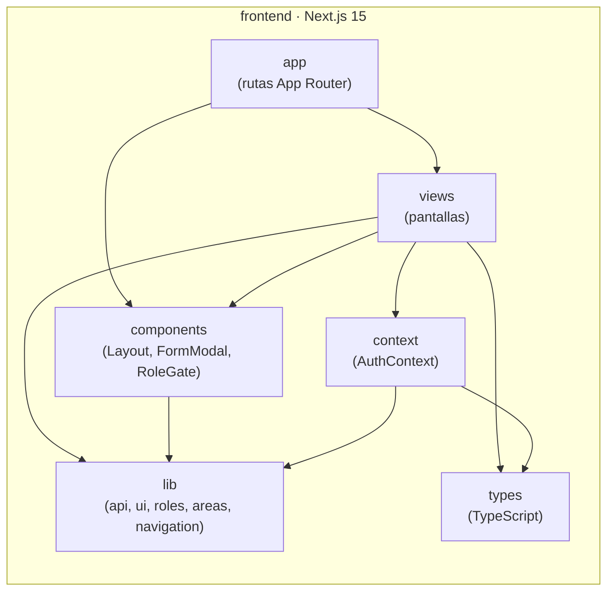
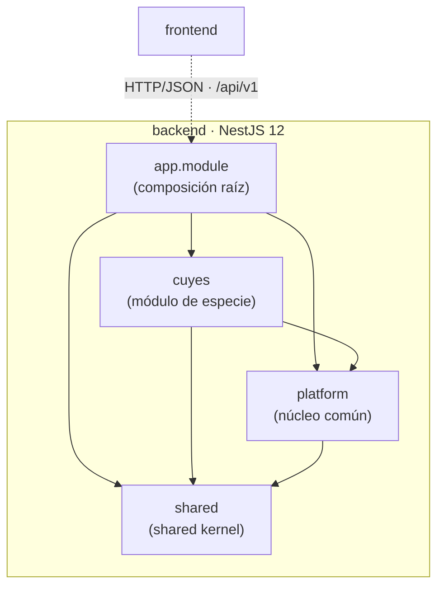
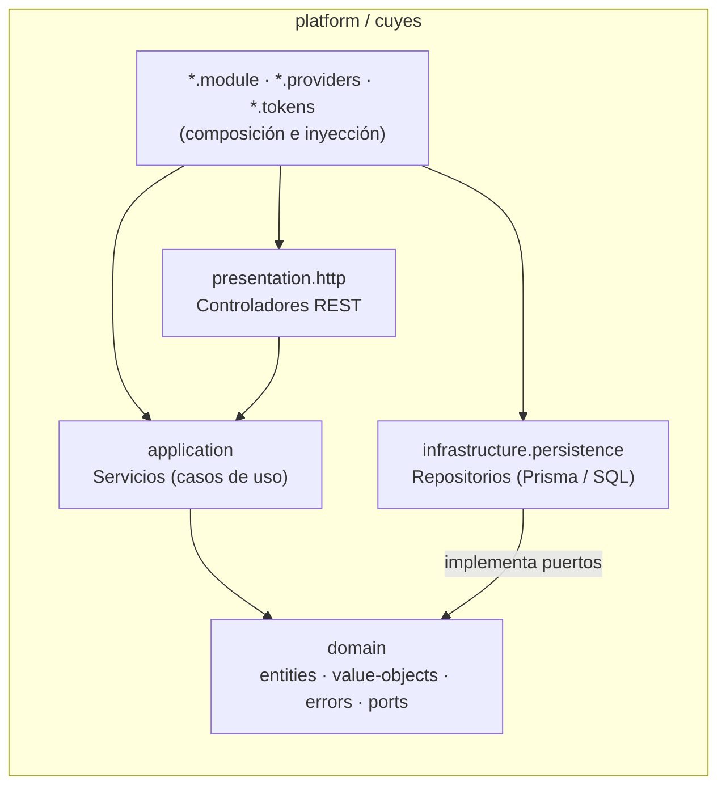
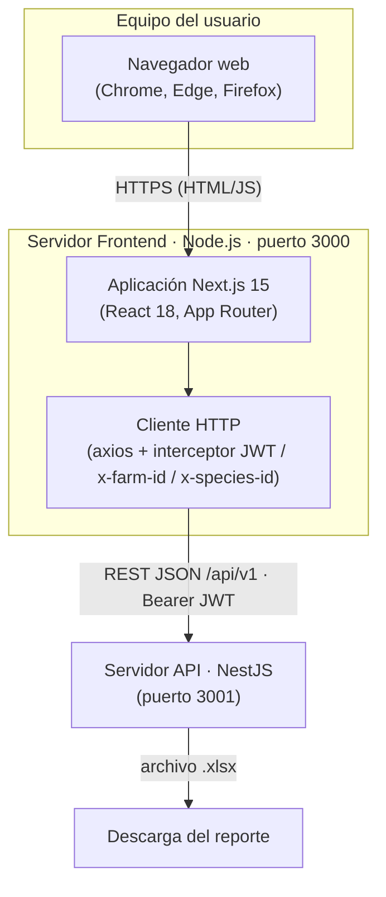
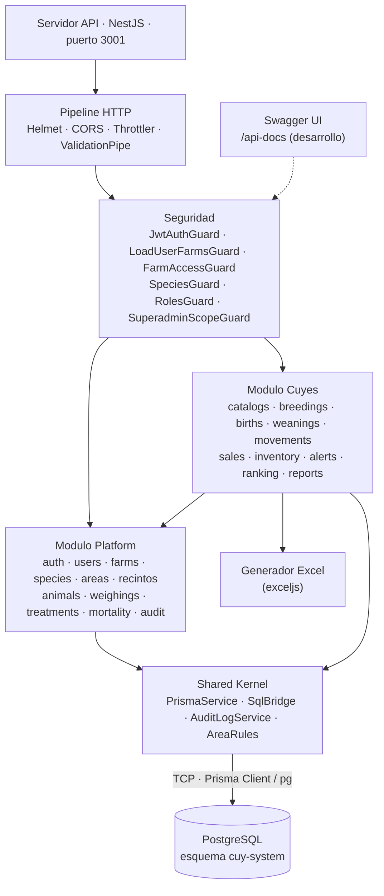

# Diseño de aplicación

## Arquitectura de software

### Estilo elegido

**Monolito modular con Clean Architecture en cada módulo**, desplegado como **cliente-servidor de tres niveles**.

| Nivel | Estilo | Decisión |
|------------|-------------------|--------------------------------------------------------|
| Sistema | Cliente-servidor | Frontend Next.js 15 ↔ API REST NestJS 12 (`/api/v1`, JSON) ↔ PostgreSQL. |
| Backend | Monolito modular | Una unidad de despliegue con los módulos `platform`, `cuyes` y `shared`. |
| Módulo | Clean Architecture | Capas `presentation` → `application` → `domain` ← `infrastructure`; las dependencias apuntan al dominio. |

| Módulo | Responsabilidad |
|------------|--------------------------------------------------------|
| `platform` | Núcleo común a cualquier especie: autenticación, usuarios, granjas, especies, áreas, jaulas, animales, pesajes, sanidad, mortalidad y auditoría. |
| `cuyes` | Reglas de la especie: catálogos, empadres, partos, destetes, movimientos, ventas, inventario, alertas, ranking y reportes Excel. |
| `shared` | Núcleo compartido: acceso a datos, guards, decoradores, auditoría y reglas de área por especie. |

Cada petición protegida lleva el token (`Authorization: Bearer`) y el contexto de trabajo (`x-farm-id`, `x-species-id`). Dentro de cada módulo, los controladores validan y delegan; los servicios aplican el caso de uso; el dominio define reglas y **puertos**; y la infraestructura implementa esos puertos con Prisma o SQL. La unión puerto–implementación se resuelve en un solo lugar (`*.providers.ts`) con la inyección de dependencias de NestJS.

### Justificación

- **Monolito y no microservicios:** el sistema atiende a una unidad universitaria con un equipo pequeño. Operaciones como parto con alta de crías, destete con traslado o venta con baja de inventario tocan varias tablas y se resuelven con una transacción ACID local, sin coordinación distribuida.
- **Clean Architecture por módulo:** aísla las reglas zootécnicas (67 días de gestación, capacidad de jaulas, comprobante único) de la base de datos y del framework, y permite probar los casos de uso con repositorios falsos.
- **Módulo por especie:** una nueva especie se añade como módulo que reutiliza `platform` sin modificarlo.

| Alternativa | Ventaja | Motivo de descarte |
|--------------------|------------------------------|--------------------------------------------|
| Monolito en capas | Rápido de iniciar. | Mezcla lo común con lo propio de la especie; difícil de extender y probar. |
| Microservicios | Escalado independiente. | Sobrecarga operativa y pérdida de consistencia inmediata en inventario y partos. |
| Hexagonal sin módulos | Desacopla infraestructura. | No organiza el código por áreas de negocio. |
| **Monolito modular + Clean Architecture** | Cohesión por módulo, transacciones locales, bajo costo. | **Seleccionada.** |

### Atributos de calidad (ISO/IEC 25010)

| Característica | Decisión de diseño | Evidencia en el sistema |
|------------------|--------------------------------------|--------------------------------------------|
| Mantenibilidad | Módulos `platform`, `cuyes`, `shared` con cuatro capas idénticas; casos de uso dependientes de puertos. | Un cambio en reproducción no afecta a usuarios ni granjas; cambiar SQL por Prisma solo tocó la infraestructura. |
| Seguridad | JWT, bcrypt, roles, aislamiento por granja, Helmet, CORS, límite de peticiones, SQL parametrizado y bitácora con valores anterior y nuevo. | Un usuario solo ve sus granjas; cada escritura deja autor, fecha y cambio. |
| Fiabilidad | Transacciones ACID en un solo proceso y borrado lógico con reactivación. | Partos, destetes, ventas y traslados se completan o se revierten por completo. |
| Adecuación funcional | Reglas en el dominio (`NormalizedCode`, `PastDate`, `NewAnimal`) y confirmaciones explícitas. | Se impiden fechas futuras y códigos duplicados; sobrecupo y animales fuera de área piden confirmación. |
| Eficiencia de desempeño | Llamadas en proceso, consultas con índices y un solo backend. | Operaciones resueltas en una petición; infraestructura apta para un servidor universitario. |
| Compatibilidad | API REST JSON documentada con OpenAPI; reportes `.xlsx`. | Otro cliente podría consumir la misma API; los reportes abren en Excel y LibreOffice. |
| Usabilidad | Formularios guiados, mensajes por campo e interfaz adaptable. | Uso en escritorio, tableta y teléfono. |
| Portabilidad | Configuración por variables de entorno y esquema SQL idempotente. | Instalación en cualquier servidor con Node.js y PostgreSQL sin cambiar código. |

### Compromisos aceptados

| Compromiso aceptado | Impacto | Mejora prevista |
|--------------------|------------------------------|--------------------------------------------|
| Un único despliegue para todo el backend | No se escala un módulo por separado. | Suficiente para la carga esperada; las fronteras permiten extraer un módulo si fuera necesario. |
| Puertos con firmas genéricas (`any`) | Menor verificación de tipos. | Tipar los puertos con los contratos del Anexo A. |
| Pocas entidades de dominio | Algunas reglas viven en los servicios. | Moverlas a entidades (por ejemplo, `Jaula.puedeRecibir(n)`). |
| Servicios que devuelven códigos HTTP | La capa de aplicación conoce la web. | Errores de dominio y un filtro de excepciones en presentación. |
| `cuyes` consulta tablas de `platform` | Acoplamiento a nivel de base de datos. | Consumir los servicios públicos de `platform`. |
| Sin pruebas automatizadas | No se aprovecha la capacidad de prueba del diseño. | Pruebas unitarias de casos de uso con puertos falsos. |

## Diagrama de paquetes

Las flechas indican "depende de".

| Paquete | Contenido |
|--------------------|--------------------------------------------------------|
| `frontend/app`, `views` | Rutas (login, selección de granja, páginas protegidas) y pantallas de cada módulo. |
| `frontend/components`, `context`, `lib` | `Layout`, `FormModal`, `RoleGate`; sesión y granja activa (`AuthContext`); cliente HTTP y tema visual. |
| `*/presentation/http` | Controladores REST: traducen HTTP y delegan. |
| `*/application` | Servicios con los casos de uso. |
| `*/domain` | Entidades (`NewAnimal`), objetos de valor (`NormalizedCode`, `PastDate`), errores y puertos. |
| `*/infrastructure/persistence` | Repositorios que implementan los puertos. |
| `shared` | Guards, decoradores, `PrismaService`, `SqlBridge`, `AuditLogService`, reglas de área. |

**Reglas de dependencia:** el dominio no importa NestJS ni Prisma; `application` depende de `domain`, nunca de `infrastructure`; `cuyes` puede depender de `platform`, nunca a la inversa; `shared` no depende de ningún módulo de negocio.

## Diagrama de componentes

| Componente | Responsabilidad | Interfaz que ofrece |
|------------------|--------------------------------------------|------------------------------|
| Aplicación Next.js | Pantallas, rutas, control de roles en el cliente y sesión. | Web en el puerto 3000 |
| Cliente HTTP (axios) | Llamadas a la API con token, granja y especie. | `api.get/post/patch/put` |
| Pipeline HTTP | Cabeceras de seguridad, CORS, límite de peticiones y validación de entrada. | — |
| Guards de seguridad | Token, granjas del usuario, acceso a la granja, especie y rol. | `@FarmScope()`, `@Roles()` |
| Módulo Platform | Funciones comunes a todas las especies. | `/auth`, `/users`, `/farms`, `/areas`, `/recintos`, `/animals`, … |
| Módulo Cuyes | Procesos productivos y reproductivos. | `/cuyes/*` |
| Shared Kernel | Acceso a datos, auditoría y reglas de área. | `PrismaService`, `SqlBridge`, `AuditLogService` |
| Generador Excel | Reportes `.xlsx` en formato de la unidad. | `GET /cuyes/reports/*` |
| PostgreSQL | Persistencia, transacciones e integridad. | Puerto 5432 |

**Despliegue:** frontend (Node.js, puerto 3000), API (Node.js, puerto 3001) y PostgreSQL (puerto 5432), en una o varias máquinas, configurados por variables de entorno (`DATABASE_URL`, `JWT_SECRET`, `JWT_EXPIRES_IN`, `CORS_ORIGIN`, `NEXT_PUBLIC_API_URL`). La especificación completa de la API está en el Anexo A.

## Aplicación de principios SOLID

| Principio | Aplicación en Cuy-System |
|------------|--------------------------------------------------------|
| **S** — Responsabilidad única | Controladores solo traducen HTTP; servicios solo coordinan su caso de uso; repositorios solo acceden a datos; cada guard verifica una sola condición; `AuditLogService` solo registra auditoría. |
| **O** — Abierto/cerrado | Una especie nueva es un módulo que importa `PlatformModule` sin modificarlo; las reglas de área se extienden implementando `AreaRulesPort` (implementación neutra en `platform`, propia en `cuyes`). |
| **L** — Sustitución de Liskov | Cada repositorio extiende la clase abstracta de su puerto; una implementación con Prisma, con SQL o falsa para pruebas es intercambiable sin que el servicio lo note. |
| **I** — Segregación de interfaces | Un puerto por agregado (`AreasRepositoryPort`, `AnimalsRepositoryPort`, …) en lugar de un repositorio general; decoradores granulares (`@CurrentUser()`, `@FarmId()`, `@Roles()`); `platform` solo exporta `RECINTOS_SERVICE`. |
| **D** — Inversión de dependencias | Los servicios dependen de puertos; la unión con la implementación se hace en `*.providers.ts` y los controladores reciben servicios por token (`@Inject(AREAS_SERVICE)`). |

